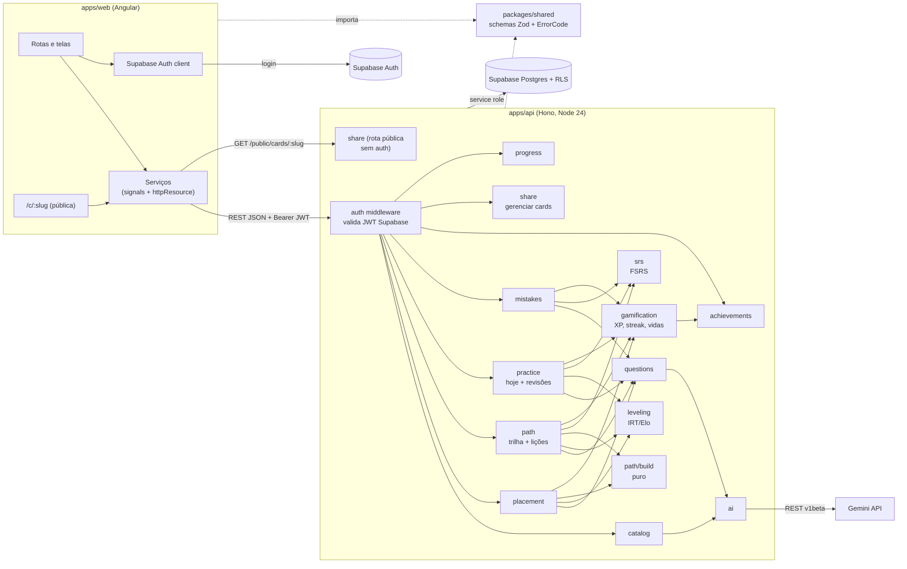
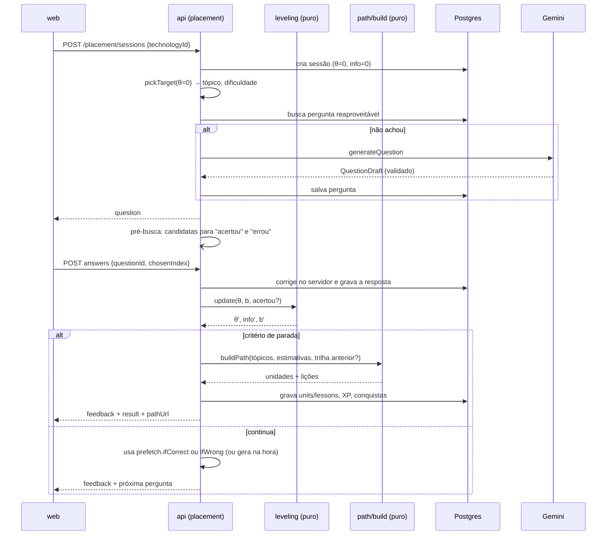
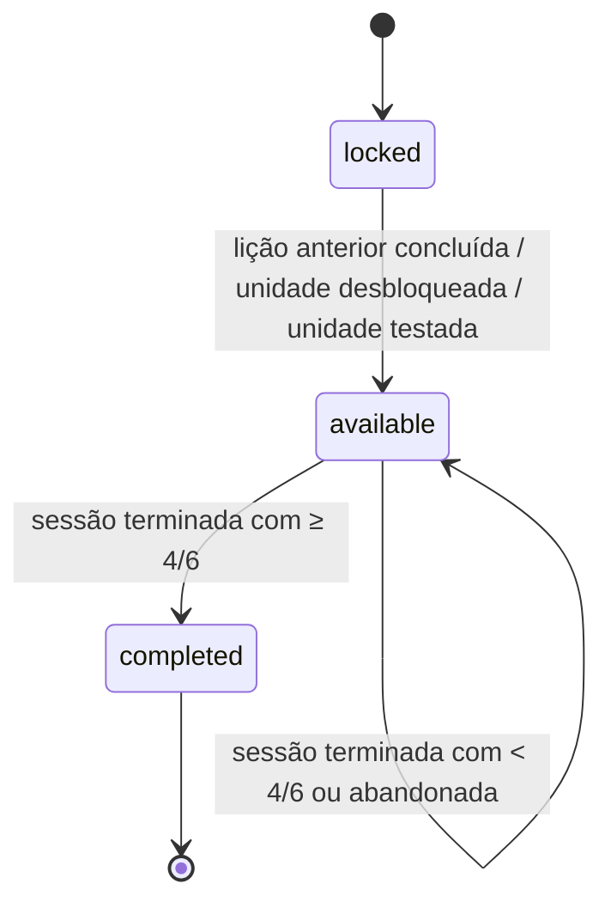

# SkillQuest — Arquitetura

> Status: rascunho v0.3 (2026-11-25). Os requisitos (RF/RNF) estão em [PRD.md](./PRD.md).
>
> v0.3: o `apps/web` passa de React para Angular (última estável), com Angular CDK + Tailwind e signals; ver [ADR 0002](./ADR/0002-angular-em-vez-de-react.md). A api, o shared, o banco e o deploy não mudam.
>
> A numeração das seções §1 a §9 foi preservada da v0.1 porque as rules (`.claude/rules/*.md`) e o PRD citam §2, §5, §6 e §7. A estrutura do monorepo entrou como §0, e a trilha, as lições, a revisão de erros, as conquistas e o card entraram como subseções de §7 e como §10.

## 0. Estrutura do monorepo

pnpm workspace (`pnpm-workspace.yaml` com `apps/*` e `packages/*`):

```
skillquest/
├─ pnpm-workspace.yaml
├─ package.json                 # scripts: dev, test, e2e, typecheck, lint
├─ apps/
│  ├─ web/                      # Angular (última estável) + Angular CDK + Tailwind (SPA, zoneless)
│  │  ├─ angular.json           # builders @angular/build:application e :unit-test (Vitest)
│  │  ├─ proxy.conf.json        # dev: ng serve encaminha /api para a api local
│  │  ├─ vercel.json            # rewrite /api/* → projeto api; SPA → index.html
│  │  └─ src/app/
│  │     ├─ app.config.ts       # provideZonelessChangeDetection, provideRouter, provideHttpClient
│  │     ├─ app.routes.ts       # rotas lazy (loadComponent): login, catálogo, nivelamento,
│  │     │                      #   trilha, lição, hoje, revisão de erros, progresso,
│  │     │                      #   conquistas, cards, /c/:slug (pública, sem authGuard)
│  │     ├─ features/<feature>/ # componentes standalone + serviços (signals, httpResource)
│  │     ├─ shared/ui/          # componentes próprios (Tailwind + Angular CDK)
│  │     └─ core/               # cliente da api tipado, interceptor de auth, supabase auth, authGuard
│  └─ api/                      # Hono, Node 24, Vercel Functions
│     ├─ api/index.ts           # entrada da Vercel Function (adapta o app Hono) — confirme o formato na doc da Vercel
│     ├─ src/
│     │  ├─ app.ts              # monta o Hono, middleware de auth, app.onError
│     │  ├─ middleware/auth.ts  # valida o JWT do Supabase, põe userId no contexto
│     │  ├─ lib/                # supabase-js (service role), clock (now), errors
│     │  └─ modules/
│     │     ├─ ai/              # QuestionGenerator, adaptadores, pipeline de validação
│     │     │  ├─ types.ts
│     │     │  ├─ gemini-rest.ts   # GeminiRestGenerator (único que conhece a URL do Gemini)
│     │     │  ├─ mock.ts          # MockGenerator (lê fixtures)
│     │     │  ├─ validate.ts      # Zod + checagens semânticas
│     │     │  ├─ usage.repo.ts    # contador diário por usuário (RNF-11)
│     │     │  └─ prompts/         # prompts versionados: classify.v1.ts, topics.v1.ts, question.v1.ts
│     │     ├─ catalog/         # routes.ts, service.ts, repo.ts (tecnologias e tópicos)
│     │     ├─ questions/       # repo.ts (reuso, salvar, b), toQuestionDTO(), report
│     │     ├─ placement/       # routes.ts, service.ts, repo.ts
│     │     ├─ leveling/        # irt.ts (puro: P, update, SE, parada, nível)
│     │     ├─ path/            # trilha + lições: routes.ts, service.ts, repo.ts, build.ts (puro)
│     │     ├─ practice/        # "Hoje" + sessão de revisões: routes.ts, service.ts, repo.ts
│     │     ├─ srs/             # fsrs.ts (toRating + wrapper do ts-fsrs, puro)
│     │     ├─ mistakes/        # revisão de erros: routes.ts, service.ts, repo.ts
│     │     ├─ gamification/    # rules.ts (puro: XP, streak, vidas), service.ts, repo.ts
│     │     ├─ achievements/    # rules.ts (puro), routes.ts, service.ts, repo.ts
│     │     ├─ share/           # cards: routes.ts (privadas + pública), service.ts, repo.ts
│     │     └─ progress/        # GET /me/progress: routes.ts, service.ts, repo.ts
│     ├─ fixtures/              # perguntas/tópicos prontos p/ MockGenerator, demo e E2E
│     └─ evals/                 # avaliação offline dos prompts (casos + script), nunca roda no CI com IA real
├─ packages/
│  └─ shared/
│     └─ src/
│        ├─ errors.ts           # enum ErrorCode + status HTTP de cada código
│        ├─ constants.ts        # constantes da trilha (§7.1), vidas, XP
│        ├─ schemas/            # Zod por domínio: catalog, placement, path, practice,
│        │                      #   mistakes, achievements, share, progress, ai (QuestionDraft…)
│        └─ index.ts            # reexporta schemas e tipos (z.infer)
├─ supabase/
│  ├─ migrations/               # SQL versionado (tabelas, RLS, índices, RPCs, seed de achievements)
│  └─ seed.sql                  # dados locais/demo (opcional)
├─ e2e/                         # Playwright *.spec.ts (AI_PROVIDER=mock)
└─ docs/                        # PRD, ARCHITECTURE, ADR/, plans/
```

Regras de dependência:
- `routes.ts` valida a entrada com schemas de `packages/shared` e chama o `service.ts`; nunca acessa o banco.
- `service.ts` tem a regra de negócio e orquestra repos, módulos puros e a IA (só via `QuestionGenerator`).
- `repo.ts` só fala com o Supabase e **sempre** filtra por `user_id` em tabelas do usuário; sem regra de negócio.
- Módulos puros (`leveling`, `srs`, `path/build.ts`, `gamification/rules.ts`, `achievements/rules.ts`) não fazem I/O e recebem `now` por parâmetro.
- Testes ficam ao lado do código (`foo.ts` → `foo.test.ts`); E2E em `e2e/`.

## 1. Módulos



- **apps/web:** só UI. Usa o Supabase **apenas para autenticar** e manda o access token como `Authorization: Bearer` para a api. Todo dado de domínio passa pela api, nunca por leitura direta do banco, porque as tabelas de perguntas guardam a resposta correta (RNF-04). A página `/c/:slug` é a única tela sem login e chama a única rota sem auth.
- **apps/api:** a única camada com segredos (chave do Gemini e service role do Supabase). Roda como **Vercel Functions** (runtime Node, ver §9), então é **stateless**: nenhum estado fica em memória entre requisições; tudo que precisa sobreviver (θ, pré-busca, vidas, sessões, contadores de uso) vai para o Postgres. Os módulos são pastas em `src/modules/*`, cada uma com as próprias rotas, o serviço e o repositório (§0). `leveling`, `srs`, `path/build`, `gamification/rules` e `achievements/rules` são funções puras, sem I/O, fáceis de testar.
- **packages/shared:** a fonte única dos contratos. Os schemas Zod de requisição e resposta de cada endpoint, o schema da saída da IA e o enum `ErrorCode` ficam aqui, e os tipos TS são derivados com `z.infer`.
- **questions** concentra o que todos os modos usam: buscar pergunta reaproveitável, gerar via `ai` quando precisar, salvar, recalibrar `b` e `toQuestionDTO()`.

## 2. Camada de IA

```ts
// apps/api/src/modules/ai/types.ts (contrato; a implementação vem depois)
interface QuestionGenerator {
  classifyTechnology(input: string): Promise<TechClassification>;   // RF-02
  generateTopics(tech: Technology): Promise<TopicDraft[]>;          // RF-03
  generateQuestion(req: {
    tech: Technology; topic: Topic; difficulty: 1 | 2 | 3 | 4 | 5;
    avoidStems: string[];                                           // evita repetir o que o usuário já viu
  }): Promise<QuestionDraft>;
}
```

Há dois adaptadores, e a variável `AI_PROVIDER` escolhe qual entra:

| Adaptador | Uso |
|---|---|
| `GeminiRestGenerator` | Produção. `POST https://generativelanguage.googleapis.com/v1beta/models/${GEMINI_MODEL}:generateContent`, com a chave no header `x-goog-api-key` e `generationConfig.responseMimeType = "application/json"` mais o schema da resposta. O texto vem em `candidates[0].content.parts[0].text`. |
| `MockGenerator` | Dev, testes (com MSW interceptando a URL do Gemini) e o modo demo (RF-13). Lê fixtures em `apps/api/fixtures/`. |

> ⚠️ Confirme na documentação oficial da Gemini API, antes de implementar: o nome exato do modelo (`gemini-3.8-flash`, informado pelo usuário e ainda não verificado), os nomes atuais dos campos de JSON schema em `generationConfig` e os limites do plano gratuito (requisições por minuto e por dia).

**Prompts versionados:** cada prompt é um módulo em `apps/api/src/modules/ai/prompts/` com nome `<tarefa>.v<N>.ts` (`classify.v1.ts`, `topics.v1.ts`, `question.v1.ts`). Mudança de texto que altere o comportamento cria `v<N+1>`; a pergunta salva guarda `model` e `prompt_version`. Os casos de avaliação ficam em `apps/api/evals/` e rodam manualmente (fora do CI) contra o Gemini real, para comparar versões.

### Pipeline de uma geração

1. **Montar o prompt:** instruções fixas e, em seguida, os dados variáveis num bloco delimitado (`<tecnologia>…</tecnologia>`). O prompt pede pt-BR, 4 opções, exatamente 1 correta, explicação de até 2 frases e a dificuldade estimada de 1 a 5.
2. **Chamar o Gemini** com timeout de 15s. Esse timeout, somado à nova tentativa do passo 5, precisa caber na duração máxima de função do plano Vercel em uso (§9).
3. `JSON.parse` e depois `QuestionDraftSchema.safeParse` (de `packages/shared`).
4. **Checagens semânticas:** as 4 opções são distintas (normalizadas), `correctIndex` fica entre 0 e 3, o enunciado e a explicação não estão vazios, e o enunciado não repete nenhum dos `avoidStems`.
5. Se falhar, faz **1 nova tentativa**, incluindo o motivo da falha no prompt. Se falhar de novo, devolve `AI_INVALID_RESPONSE`.
6. HTTP 429 ou erro de cota viram `AI_QUOTA_EXCEEDED` (RNF-06). Nesse caso, o serviço tenta reaproveitar uma pergunta salva antes de devolver o erro.

**Limite por usuário (RNF-11):** antes de cada `generateQuestion` (incluindo a pré-busca), `ai/usage.repo.ts` incrementa atomicamente `ai_usage_daily(user_id, day)` (RPC SQL `increment_ai_usage`, que devolve o novo valor). Acima de `AI_DAILY_LIMIT_PER_USER` (padrão 100), não gera: o serviço tenta reaproveitar uma pergunta salva com a dificuldade mais próxima e, se não houver, devolve `RATE_LIMITED`. A pré-busca simplesmente não acontece quando o limite estourou.

**Entrada livre (RF-02):** `trim`, minúsculas, até 40 caracteres, só `[a-z0-9 .+#-]`. O texto é procurado primeiro em `technologies.slug` e em `technologies.aliases`. Só se não estiver lá, chama `classifyTechnology`, que devolve `{ isTechnology, canonicalName, slug, aliases }`. Se `isTechnology` for falso, a api devolve `NOT_A_TECHNOLOGY`.

## 3. Modelo de dados (Postgres / Supabase)

Todas as tabelas têm RLS habilitado. A api acessa o banco com a service role e **sempre** filtra pelo `user_id` tirado do JWT validado. As políticas RLS existem para bloquear o acesso direto de clientes com a anon key. "Nenhum acesso" significa RLS ligado e nenhuma política para `anon` nem `authenticated`.

### 3.1 Tabelas existentes (v0.1, com acréscimos em negrito)

| Tabela | Colunas principais | RLS (clientes autenticados) |
|---|---|---|
| `profiles` | `id` (PK = `auth.users.id`), `display_name`, `timezone` (IANA), `created_at` | select e update do próprio registro |
| `technologies` | `id`, `slug` (unique), `name`, `aliases text[]`, `created_at` | select para todos os autenticados |
| `topics` | `id`, `technology_id` (FK), `slug`, `name`, `position`; unique(`technology_id`, `slug`) | select para todos os autenticados |
| `questions` | `id`, `technology_id`, `topic_id`, `stem`, `options jsonb` (4 strings), `correct_index smallint`, `explanation`, `difficulty_ai smallint` (1–5), `difficulty_b real`, `times_answered int`, `times_correct int`, `reports int`, `status` (`active` / `retired`; **vira `retired` com 3 reports**), `model`, **`prompt_version text`**, `created_at` | **nenhum acesso** (só a service role) |
| `placement_sessions` | `id`, `user_id`, `technology_id`, `status` (`active` / `finished` / `abandoned`), `theta real`, `info real` (informação acumulada), `current_question_id`, **`current_served_at timestamptz`** (quando a pergunta atual foi entregue), `prefetch jsonb` (`{ ifCorrect, ifWrong }` → ids de pergunta), `started_at`, `finished_at` | select dos próprios |
| `answers` | `id`, `user_id`, `question_id`, `context` (`placement` / `practice` / **`lesson`** / **`mistakes`**), `session_id` (de `placement_sessions` ou `study_sessions`, conforme `context`), `chosen_index`, `is_correct`, **`hint_used bool`** (padrão false), **`response_ms int`** (medido no servidor, §7.4), `theta_before`, `answered_at` | select dos próprios |
| `skill_estimates` | PK(`user_id`, `technology_id`, `topic_id` nullable → `NULL` = nível geral), `theta`, `info`, `answers_count`, `updated_at` | select dos próprios |
| `review_items` | PK(`user_id`, `question_id`); **estado do cartão FSRS**, espelhando o tipo `Card` do `ts-fsrs` na versão instalada (por exemplo `due timestamptz`, `stability real`, `difficulty real`, `elapsed_days int`, `scheduled_days int`, `reps int`, `lapses int`, `state smallint`, `last_review timestamptz`; confira os campos ao instalar, §7.4) | select dos próprios |
| `xp_events` | `id`, `user_id`, `amount`, `reason` (`answer` / `session_complete` / `placement`), `ref_id`, `created_at` | select dos próprios |
| `user_stats` | PK `user_id`, `xp_total`, `streak_current`, `streak_best`, `last_active_date date`, `lives smallint`, `lives_updated_at` | select dos próprios |

### 3.2 Tabelas novas (v0.2)

| Tabela | Colunas principais | RLS (clientes autenticados) |
|---|---|---|
| `units` | `id`, `user_id`, `technology_id`, `topic_id`, `position smallint` (ordem na trilha, 0..n−1), `status` (`locked` / `available` / `completed` / `tested`), `theta_at_build real` (θ do tópico quando a trilha foi montada), `completed_at`, `updated_at`; unique(`user_id`, `technology_id`, `topic_id`) | select dos próprios |
| `lessons` | `id`, `unit_id` (FK), `user_id` (denormalizado para filtrar e para o RLS), `position smallint` (0, 1, 2), `status` (`locked` / `available` / `completed`), `best_correct smallint` nullable, `attempts int` (padrão 0), `completed_at`; unique(`unit_id`, `position`) | select dos próprios |
| `study_sessions` | `id`, `user_id`, `technology_id`, `kind` (`practice` / `lesson` / `mistakes`), `lesson_id` nullable (FK, só para `lesson`), `slots jsonb` (`[{ difficulty, topicId, questionId \| null, servedAt \| null, hintIndex \| null }]`), `answered_count smallint`, `correct_count smallint`, `status` (`active` / `finished` / `abandoned`), `started_at`, `last_answer_at`, `finished_at` | select dos próprios |
| `achievements` | `id`, `slug` (unique), `name`, `description`, `icon`, `position`; seed por migration com as 8 do PRD §3.7 | select para todos os autenticados |
| `user_achievements` | PK(`user_id`, `achievement_id`), `unlocked_at`, `ref_id` (sessão que desbloqueou) | select dos próprios |
| `share_cards` | `id`, `user_id`, `technology_id`, `slug text` (unique; 16 caracteres base64url = 96 bits), `display_name` (2–30 caracteres, sem `@`), `active bool`, `views int` (padrão 0), `created_at`, `deactivated_at`; índice único parcial (`user_id`, `technology_id`) `where active` | **nenhum acesso** (nem para o dono; tudo via api) |
| `ai_usage_daily` | PK(`user_id`, `day date` em UTC), `generations int` | **nenhum acesso** |

`study_sessions` guarda as sessões de revisão do "Hoje" (`kind = practice`, que já eram referenciadas por `sessionId` na v0.1), as lições e a revisão de erros. O progresso persistente da trilha fica em `units` e `lessons`; cada tentativa de lição é uma linha em `study_sessions`.

Índices:
- `questions(technology_id, topic_id, status, difficulty_b)` para reaproveitar perguntas (§5);
- `review_items(user_id, due)` para a prática;
- `answers(user_id, question_id, answered_at desc)` para a revisão de erros (última resposta por pergunta);
- `units(user_id, technology_id, position)` e `lessons(unit_id, position)` para montar a trilha;
- `study_sessions(user_id, status)` para achar a sessão ativa.

**Funções SQL (RPC)** chamadas via `supabase-js`, para operações atômicas sem pool `pg`: `increment_ai_usage(user_id, day)`, `increment_card_views(slug)`, `latest_wrong_questions(user_id, technology_id, limit)` (§7.5).

As migrations ficam em `supabase/migrations/`; o seed de `achievements` é uma migration própria.

## 4. Contratos de API

Base: `/api/v1`. Todas as rotas exigem `Authorization: Bearer <supabase access token>`, **exceto** `GET /public/cards/:slug`. Os corpos, query e params são validados com os schemas de `packages/shared`. Recurso de outro usuário responde `NOT_FOUND` (não revela que existe).

**Uma pergunta, como o cliente a recebe** (sem a resposta correta). Toda pergunta sai da api por `toQuestionDTO()` (em `modules/questions`), que remove `correct_index` e `explanation`:

```ts
type QuestionDTO = { id: string; topic: { slug: string; name: string }; stem: string; options: [string, string, string, string]; difficulty: 1|2|3|4|5 };
type AnswerFeedback = { correct: boolean; correctIndex: number; explanation: string };
type Progress = { answered: number; total: number };
```

### 4.1 Catálogo, nivelamento, prática e progresso

| Método e rota | Requisição | Resposta 200 | Erros |
|---|---|---|---|
| `POST /technologies/resolve` | `{ input: string }` | `{ technology: { id, slug, name }, topics: { slug, name }[] }` (gera os tópicos se a tecnologia for nova) | `VALIDATION_ERROR`, `NOT_A_TECHNOLOGY`, `AI_*`, `RATE_LIMITED` |
| `POST /placement/sessions` | `{ technologyId }` | `{ sessionId, question: QuestionDTO, progress: { answered: 0, total: 20 } }` (`total` é o máximo; o nivelamento pode parar antes, §6) | `NOT_FOUND`, `PLACEMENT_COOLDOWN`, `AI_*`, `RATE_LIMITED` |
| `POST /placement/sessions/:id/answers` | `{ questionId, chosenIndex }` | `{ feedback, next: { question } \| { result: PlacementResult, pathUrl: string }, progress, newAchievements: AchievementDTO[] }` | `NOT_FOUND`, `SESSION_FINISHED`, `VALIDATION_ERROR`, `AI_*` |
| `GET /practice/today?technologyId=` | — | `TodayDTO` (abaixo) | `PLACEMENT_REQUIRED`, `NOT_FOUND` |
| `POST /practice/answers` | `{ sessionId, questionId, chosenIndex }` | `{ feedback, xpGained, lives, sessionComplete: boolean, newAchievements }` | `NO_LIVES`, `SESSION_FINISHED`, `NOT_FOUND` |
| `GET /me/progress` | — | `{ xpTotal, streak: { current, best }, lives, livesRefillAt, achievementsUnlocked: number, technologies: { id, name, level, theta, unitsCompleted, unitsTotal, mistakesPending, topics: { slug, name, level }[] }[] }` | — |
| `POST /questions/:id/report` | `{ reason: string }` (≤ 280 caracteres) | `204` | `NOT_FOUND` |

```ts
type PlacementResult = { level: Level; theta: number; topics: { slug: string; name: string; level: Level; strength: "forte" | "fraco" | "neutro" }[] };
type Level = "iniciante" | "basico" | "intermediario" | "avancado" | "especialista";

type TodayDTO = {
  review: { sessionId: string; questions: QuestionDTO[] } | null;  // até 5 vencidas; até 10 com reforço (§7.3); null se nada
  nextLesson: { lessonId: string; unit: { id: string; topic: { slug: string; name: string } }; position: 0|1|2 } | null;
  dailyGoalDone: boolean;                                          // last_active_date = hoje no fuso do usuário
  lives: number; livesRefillAt: string | null;
};
```

A sessão de revisão (`review`) mantém o modelo da v0.1: as perguntas vêm todas de uma vez, porque são reaproveitadas (revisões) ou, no reforço, geradas na criação da sessão.

### 4.2 Trilha e lições

| Método e rota | Requisição | Resposta 200 | Erros |
|---|---|---|---|
| `GET /paths/:technologyId` | — | `PathDTO` | `PLACEMENT_REQUIRED` (nenhum nivelamento concluído), `NOT_FOUND` |
| `POST /lessons/:lessonId/sessions` | — | `{ sessionId, question: QuestionDTO, progress: { answered: 0, total: 6 }, lives }` (se já há sessão `active` desta lição, retoma e devolve a pergunta atual) | `LESSON_LOCKED`, `NO_LIVES`, `NOT_FOUND`, `AI_*`, `RATE_LIMITED` |
| `POST /lessons/sessions/:sessionId/answers` | `{ questionId, chosenIndex }` | `{ feedback, xpGained, lives, progress, next: { question } \| { result: LessonResult }, newAchievements }` | `NO_LIVES`, `SESSION_FINISHED`, `VALIDATION_ERROR` (pergunta não é a atual), `NOT_FOUND`, `AI_*` |

```ts
type PathDTO = {
  technology: { id: string; slug: string; name: string };
  level: Level;
  nextLessonId: string | null;
  units: {
    id: string; position: number;
    topic: { slug: string; name: string }; topicLevel: Level;
    status: "locked" | "available" | "completed" | "tested";
    lessons: { id: string; position: 0|1|2; status: "locked" | "available" | "completed"; bestCorrect: number | null }[];
  }[];
};
type LessonResult = {
  passed: boolean; correctCount: number; total: 6; xpGained: number;   // xpGained = total da sessão
  unitCompleted: boolean; unlockedLessonId: string | null; unlockedUnitId: string | null;
};
```

### 4.3 Revisão de erros

| Método e rota | Requisição | Resposta 200 | Erros |
|---|---|---|---|
| `GET /mistakes?technologyId=` | — | `{ pending: number }` | `NOT_FOUND` |
| `POST /mistakes/sessions` | `{ technologyId }` | `{ sessionId, questions: QuestionDTO[] (≤ 10), progress: { answered: 0, total } }` | `NO_MISTAKES`, `NOT_FOUND` |
| `POST /mistakes/sessions/:sessionId/answers` | `{ questionId, chosenIndex }` | `{ feedback, xpGained, progress, sessionComplete: boolean, newAchievements }` (sem `lives`: não gasta) | `SESSION_FINISHED`, `VALIDATION_ERROR`, `NOT_FOUND` |

### 4.4 Conquistas

| Método e rota | Requisição | Resposta 200 | Erros |
|---|---|---|---|
| `GET /achievements` | — | `{ achievements: AchievementDTO[] }` (todas, com `unlockedAt` nulo nas bloqueadas, ordenadas por `position`) | — |

```ts
type AchievementDTO = { slug: string; name: string; description: string; icon: string; unlockedAt: string | null };
```

### 4.5 Card público

| Método e rota | Auth | Requisição | Resposta | Erros |
|---|---|---|---|---|
| `GET /share-cards` | sim | — | `200 { cards: ShareCardDTO[] }` (só os ativos) | — |
| `POST /share-cards` | sim | `{ technologyId, displayName }` | `200 ShareCardDTO`. Idempotente: se já há card ativo para a tecnologia, devolve o existente com o `displayName` atualizado | `PLACEMENT_REQUIRED`, `VALIDATION_ERROR` (nome fora de 2–30, com `@` ou fora do charset), `NOT_FOUND` |
| `DELETE /share-cards/:id` | sim | — | `204` (marca `active = false`, `deactivated_at = now`) | `NOT_FOUND` |
| `GET /public/cards/:slug` | **não** | — | `200 PublicCardDTO`, com `Cache-Control: public, max-age=60` | `NOT_FOUND` (slug inexistente **ou** inativo, mesma resposta) |

```ts
type ShareCardDTO = { id: string; technology: { id: string; name: string }; displayName: string; url: string; active: true; createdAt: string };
// PublicCardSchema é z.object({...}).strict(): a rota faz parse do objeto antes de enviar,
// então qualquer campo a mais quebra o teste, não vaza.
type PublicCardDTO = { displayName: string; technology: { name: string }; level: Level; updatedAt: string };
```

- `slug`: `crypto.randomBytes(12).toString("base64url")` (16 caracteres, 96 bits). Reativar = novo `POST`, que cria linha nova com slug novo.
- `displayName`: `trim`, 2–30 caracteres, letras (com acento), dígitos, espaço e `. _ -`; recusa `@`. O formulário pré-preenche com `profiles.display_name` só se ele existir; nunca com o e-mail.
- `level`: calculado na leitura a partir de `skill_estimates` (θ geral, `topic_id IS NULL`) pela tabela do §6. `updatedAt` = `skill_estimates.updated_at`.
- `views`: incrementado com `increment_card_views` dentro de `waitUntil`, para não atrasar a resposta.
- `url`: `${PUBLIC_WEB_URL}/c/<slug>`.

### 4.6 Erros

**Formato** (4xx e 5xx): `{ error: { code: ErrorCode, message: string, retryAfterSeconds?: number } }`, lançado só pelo `app.onError`. O enum fica em `packages/shared/src/errors.ts`:

| `ErrorCode` | HTTP | Quando |
|---|---|---|
| `UNAUTHORIZED` | 401 | sem token ou token inválido |
| `VALIDATION_ERROR` | 400 | body/query/params fora do schema; pergunta respondida não é a atual da sessão |
| `NOT_FOUND` | 404 | recurso inexistente ou de outro usuário; card inexistente ou inativo |
| `NOT_A_TECHNOLOGY` | 422 | RF-02 |
| `NO_LIVES` | 409 | resposta em lição ou revisão com 0 vidas, ou iniciar lição com 0 vidas; inclui `retryAfterSeconds` até a próxima vida |
| `PLACEMENT_COOLDOWN` | 409 | RF-12 |
| **`PLACEMENT_REQUIRED`** | 409 | trilha, "Hoje" ou card sem nivelamento concluído na tecnologia |
| **`LESSON_LOCKED`** | 409 | iniciar lição com `status = locked` (RF-16) |
| **`SESSION_FINISHED`** | 409 | responder em sessão `finished` ou `abandoned` |
| **`NO_MISTAKES`** | 409 | iniciar revisão de erros sem erros pendentes (RF-18) |
| **`RATE_LIMITED`** | 429 | limite diário de gerações por usuário sem pergunta salva para usar (RNF-11), com `retryAfterSeconds` até a meia-noite UTC |
| `AI_QUOTA_EXCEEDED` | 503 | cota do Gemini, com `retryAfterSeconds` |
| `AI_INVALID_RESPONSE` | 502 | validação falhou 2 vezes |

### 4.7 Dica (RF-23)

| Método e rota | Requisição | Resposta 200 | Erros |
|---|---|---|---|
| `POST /study-sessions/:sessionId/hint` | `{ questionId }` | `{ eliminatedIndex: number }` | `NOT_FOUND`, `SESSION_FINISHED`, `VALIDATION_ERROR` (pergunta não é a atual da sessão) |

- Vale para qualquer `study_session` `active` (lição, revisão do "Hoje" ou revisão de erros). **Não existe no nivelamento**, porque a dica distorceria θ.
- O servidor sorteia uma das 3 alternativas erradas, grava em `slots[i].hintIndex` e devolve só esse índice; a resposta correta continua sem ir ao cliente (RNF-04).
- Idempotente: chamar de novo para a mesma pergunta devolve o mesmo `eliminatedIndex`. Uma dica por pergunta.
- A resposta seguinte grava `answers.hint_used = true`. Efeitos: nota Hard no FSRS se acertar (§7.4), metade do XP (§7.6), sem efeito em θ nem em `b` (§6). A dica não gasta vida.

## 5. Fluxo do quiz adaptativo



- **`pickTarget(θ, sessão)`:** o tópico é o que tem menos respostas nesta sessão (empate desempatado pela ordem dos tópicos). A dificuldade alvo é `clamp(round(θ) + 3, 1, 5)`.
- **Reaproveitar uma pergunta:** `status = active`, mesmo tópico, `|difficulty_b − θ| ≤ 0,5`, e o usuário nunca a respondeu. Se houver várias, escolhe aleatoriamente entre elas. Se não houver, gera uma nova (geração em tempo real).
- **Pré-busca:** logo depois de enviar uma pergunta, a api calcula θ para os casos "acertou" e "errou", prepara uma pergunta para cada (reaproveitando ou gerando) e grava os ids em `placement_sessions.prefetch`. Quando a resposta chega, a pergunta seguinte já está pronta. Se a pré-busca não terminou a tempo, gera na hora. Cada pergunta gasta até 2 gerações; entra no cálculo da cota.
  - Na Vercel, a função pode ser congelada assim que a resposta sai. Por isso, a pré-busca é registrada com `waitUntil` (pacote `@vercel/functions`), que mantém a função viva até a promise terminar, dentro da duração máxima. Uma promise solta, sem `waitUntil`, pode simplesmente não rodar.
  - Como o resultado vai para o banco, a próxima requisição pode cair em outra instância da função e ainda assim encontrar a pergunta pronta.
- **Ao concluir:** a montagem da trilha (§7.1) roda na mesma requisição da última resposta, antes de responder (é puro e barato, RNF-09). O nivelamento concluído também dá XP (§7.6) e avalia conquistas (§7.7).

## 6. Algoritmo de nível (IRT 1PL / Elo)

Habilidade do usuário (θ) e dificuldade da pergunta (b) ficam na mesma escala logit, por volta de −3 a +3.

```
P(acerto)  = 1 / (1 + e^-(θ − b))
θ'         = θ + K_n · (r − P)          r = 1 se acertou, 0 se errou
K_n        = max(0,3; 0,8 · 0,9^n)      n = respostas já dadas na sessão
info'      = info + P · (1 − P)         informação de Fisher (1PL)
SE         = 1 / √info
```

- **b inicial** vem da dificuldade estimada pela IA: 1 → −2, 2 → −1, 3 → 0, 4 → +1, 5 → +2.
- **Recalibrar b:** depois que a pergunta tem pelo menos 5 respostas, cada nova resposta faz `b' = b − K_q · (r − P)`, com `K_q = 0,05`. Acertos inesperados baixam b, erros inesperados sobem.
- **Parada:** no mínimo 8 perguntas e `SE < 0,6`, ou no máximo 20. Com P ≈ 0,5, cada pergunta soma cerca de 0,25 de informação, então `SE < 0,6` (info > 2,78) costuma ser atingido por volta da 11ª pergunta, dentro da meta de ≤ 14 do PRD. Ajuste o limiar com os dados reais.
- **θ por tópico:** além do θ geral, cada tópico tem a própria estimativa em `skill_estimates`, atualizada com a mesma regra a partir de θ_tópico = θ geral no momento da primeira resposta do tópico. Um tópico é "forte" se θ_tópico ≥ θ + 0,5, "fraco" se θ_tópico ≤ θ − 0,5, e "neutro" no resto ou com menos de 2 respostas.
- **θ vira nível:**

  | Faixa de θ | Nível |
  |---|---|
  | θ < −1,5 | iniciante |
  | −1,5 ≤ θ < −0,5 | básico |
  | −0,5 ≤ θ < 0,5 | intermediário |
  | 0,5 ≤ θ < 1,5 | avançado |
  | θ ≥ 1,5 | especialista |

  O θ geral também é atualizado na prática diária, com K fixo de 0,3, para o nível evoluir. Nas **lições** e nas **revisões** vale a mesma regra (K = 0,3) para o θ geral e para o θ do tópico da pergunta. A **revisão de erros não altera θ** (a pessoa já viu a resposta certa, então o acerto não mede habilidade). A recalibração de `b` vale para qualquer contexto, exceto `mistakes`. Uma resposta dada **com dica** (§4.7) também não altera θ nem `b`, porque não mede só habilidade.

**Exemplo:**

| Passo | θ | b | P | resultado | K | θ' |
|---|---|---|---|---|---|---|
| 1 | 0 | 0 (dif. 3) | 0,50 | acertou | 0,80 | 0 + 0,8·0,5 = **0,40** |
| 2 | 0,40 | 0 (dif. 3) | 0,60 | errou | 0,72 | 0,40 − 0,72·0,60 = **−0,03** |
| 3 | −0,03 | 0 (dif. 3) | 0,49 | acertou | 0,65 | −0,03 + 0,65·0,51 = **0,30** |

## 7. Trilha, prática diária e gamificação

### 7.1 Algoritmo de geração da trilha (`path/build.ts`, puro)

Constantes (em `packages/shared/src/constants.ts`, para a web exibir os mesmos números):

| Constante | Valor |
|---|---|
| `LESSONS_PER_UNIT` | 3 |
| `QUESTIONS_PER_LESSON` | 6 |
| `PASS_CORRECT` | 4 (de 6) |
| `DOMINATED_THETA` | 0,5 (início da faixa "avançado") |
| `DOMINATED_MIN_ANSWERS` | 2 |

Entradas: os tópicos da tecnologia (com `position`), as estimativas por tópico e o θ geral (de `skill_estimates`), e a trilha anterior, se existir (refazer nivelamento). Saída: a lista ordenada de unidades com o status de cada lição. O serviço grava o resultado com upsert em `units` (por `user_id, technology_id, topic_id`) e `lessons` (por `unit_id, position`).

```ts
function buildPath(topics, estimates, thetaGeral, previous?: UnitState[]): UnitState[] {
  const prev = new Map(previous?.map(u => [u.topicId, u]));

  // 1. θ e "dominado" por tópico
  const scored = topics.map(t => {
    const e = estimates.get(t.id);
    const n = e?.answersCount ?? 0;
    const theta = n > 0 ? e.theta : thetaGeral;        // sem respostas: herda o θ geral
    const dominated = n >= DOMINATED_MIN_ANSWERS && theta >= DOMINATED_THETA;
    return { topic: t, theta, dominated };
  });

  // 2. status base de cada unidade (nada que foi concluído ou desbloqueado regride)
  const units = scored.map(s => {
    const p = prev.get(s.topic.id);
    if (p?.status === "completed") return { ...p, theta: s.theta };
    if (s.dominated) return { ...base(s, p), status: "tested", lessons: openAll(p?.lessons) };
    if (p && p.status !== "locked")                    // era available ou tested
      return { ...base(s, p), status: "available", lessons: keepOpen(p.lessons) };
    return { ...base(s, p), status: "locked", lessons: allLocked() };
  });

  // 3. ordem: concluídas primeiro (na ordem anterior), depois as demais por θ crescente
  const done = units.filter(u => u.status === "completed").sort(by(u => u.prevPosition));
  const rest = units.filter(u => u.status !== "completed")
                    .sort(by(u => u.theta, u => u.topic.position));   // desempate: ordem do tópico
  const ordered = [...done, ...rest].map((u, i) => ({ ...u, position: i }));

  // 4. desbloqueio sequencial
  return unlockNext(ordered);
}

// Também usada quando uma lição é concluída (sem recalcular a trilha).
function unlockNext(units: UnitState[]): UnitState[] {
  for (const u of units) {
    if (u.status === "completed" || u.status === "tested") continue;
    if (u.status === "locked") { u.status = "available"; u.lessons[0].status = "available"; }
    break;                                             // só a primeira unidade pendente
  }
  return units;
}
```

Notas:
- `openAll` deixa as 3 lições `available`, mantendo as `completed`. `keepOpen` mantém o status de cada lição e garante que a lição 0 esteja pelo menos `available`.
- Uma unidade `tested` vira `completed` quando o usuário conclui as 3 lições dela.
- Na primeira montagem não há `previous`: tudo começa `locked` ou `tested`, e `unlockNext` abre a 1ª unidade não testada.
- Se todas as unidades forem `tested` (usuário especialista), não há nada bloqueado; a "próxima lição" (§7.3) é a primeira lição não concluída da 1ª unidade, e quando tudo estiver concluído, o "Hoje" vira reforço.

**Quando a trilha muda:**

| Evento | O que acontece |
|---|---|
| Nivelamento concluído pela 1ª vez | `buildPath(..., previous = undefined)` |
| Lição concluída (≥ 4/6) | lição seguinte `available`; se era a última, unidade `completed` e `unlockNext` |
| Lição terminada com < 4/6 | nada muda na trilha; `attempts += 1`, `best_correct = max(...)` |
| θ muda em lições/revisões | a ordem **não** muda; só a dificuldade da próxima lição, que é calculada ao iniciá-la (§7.2) |
| Nivelamento refeito (RF-12) | `buildPath(..., previous = trilha atual)`: reordena as não concluídas, aplica `tested` e mantém o progresso |

**Exemplo** (React, θ geral = 0,2 ao fim do nivelamento):

| Tópico (`position`) | Respostas no tópico | θ_tópico | Dominado? | Posição na trilha | Status inicial |
|---|---|---|---|---|---|
| Componentes (0) | 3 | 0,9 | sim | 4 | `tested` (3 lições abertas) |
| Hooks (1) | 3 | −0,8 | não | 0 | `available` (lição 0 aberta) |
| Estado (2) | 2 | 0,1 | não | 1 | `locked` |
| Roteamento (3) | 0 | 0,2 (herdado do geral) | não | 2 | `locked` |
| Performance (4) | 1 | 0,7 | não (só 1 resposta) | 3 | `locked` |

Ordenando por θ: Hooks (−0,8), Estado (0,1), Roteamento (0,2), Performance (0,7), Componentes (0,9). Entre as pendentes, só Hooks/lição 0 está aberta; Componentes, por ser `tested`, está toda aberta. Quando as 3 lições de Hooks forem concluídas, `unlockNext` abre Estado.

Se o usuário refizer o nivelamento 7 dias depois, com Hooks já concluída, e Estado sair com θ = 0,8 em 3 respostas: Hooks fica `completed` na posição 0, Estado vira `tested`, e Roteamento passa a ser a próxima pendente (desbloqueada por `unlockNext`).

### 7.2 Lições

**Dificuldade (calculada ao iniciar a sessão da lição, com o θ_tópico atual):**

```
d_j    = clamp(round(θ_tópico) + 1 + j, 1, 4)       j = posição da lição (0, 1, 2)
slots  = [d_j, d_j, d_j, d_j + 1, d_j + 1, d_j + 1]  6 perguntas, dificuldade crescente
```

Com θ_tópico = −0,8 (Hooks no exemplo): `round = −1`; lição 0 → d = 1 → `[1,1,1,2,2,2]`; lição 1 → d = 1 → `[1,1,1,2,2,2]`; lição 2 → d = 2 → `[2,2,2,3,3,3]`. Se, depois das lições 0 e 1, θ_tópico subir para −0,2, a lição 2 sai com d = clamp(0 + 1 + 2) = 3 → `[3,3,3,4,4,4]`. A última lição da unidade termina 1 nível acima da dificuldade alvo do §5 (`round(θ) + 3`), como desafio.

**Seleção das perguntas:** para cada slot de dificuldade d, reaproveita uma pergunta do tópico com `status = active`, `|difficulty_b − (d − 3)| ≤ 0,5` e nunca respondida pelo usuário; se não houver, gera (`avoidStems` = enunciados já vistos pelo usuário no tópico). Não se gera a lição inteira de uma vez: ao iniciar, a api resolve o slot 0 na hora e registra com `waitUntil` a pré-busca dos **2 próximos slots**; a cada resposta, pré-busca os 2 slots seguintes que ainda estiverem vazios. Os ids vão para `study_sessions.slots`. Se o slot da vez ainda estiver vazio quando a resposta anterior chegar, gera na hora.

**Regras da sessão:**
- Só uma sessão de lição `active` por usuário. Iniciar outra lição marca a anterior como `abandoned`; iniciar a mesma lição retoma a sessão ativa.
- Sessão de lição sem resposta há mais de 24h (`last_answer_at`, ou `started_at` se não houver resposta) é marcada `abandoned` na próxima vez que o usuário iniciar qualquer lição (limpeza preguiçosa, sem cron).
- Erro custa 1 vida (§7.6). Com 0 vidas, a resposta seguinte devolve `NO_LIVES`; a sessão continua `active` e pode ser retomada quando as vidas regenerarem (dentro das 24h).
- Terminada (6 respostas): `finished`. Se `correct_count ≥ 4`, a lição é concluída (§7.1); senão, pode ser repetida.
- Cada resposta atualiza θ (§6), `b`, `review_items` (§7.4) e grava `answers` com `context = lesson`.



### 7.3 Prática do dia ("Hoje")

`GET /practice/today?technologyId=` monta:
1. **Revisões:** até 5 `review_items` vencidos (`due ≤ agora`) da tecnologia, os mais atrasados primeiro. Se houver pelo menos 1, cria uma `study_session` com `kind = practice` e devolve as perguntas. Se já existe uma sessão `practice` ativa da tecnologia criada hoje, devolve essa (idempotente ao recarregar a tela).
2. **Lição do dia:** a próxima lição da trilha = a primeira lição `available` (não concluída), percorrendo as unidades por `position` e ignorando unidades `tested`; se não houver, a primeira lição não concluída de uma unidade `tested`; se não houver, `null`.
3. **Reforço:** se a lição do dia for `null` (trilha toda concluída), a sessão de revisão é completada até 10 perguntas com perguntas dos 2 tópicos com menor θ_tópico, na dificuldade alvo `clamp(round(θ_tópico) + 3, 1, 5)`, reaproveitando ou gerando como no §5 (regra da v0.1).

A meta diária está cumprida (`dailyGoalDone`) quando `user_stats.last_active_date` é hoje no fuso do usuário, ou seja, quando ele terminou qualquer sessão no dia (§7.6). Na interface, o "Hoje" sugere fazer primeiro as revisões e depois a lição.

### 7.4 Repetição espaçada (FSRS via `ts-fsrs`)

Decisão registrada em [ADR 0001](./ADR/0001-fsrs-em-vez-de-sm2.md). O agendamento usa a biblioteca `ts-fsrs` (confirme a versão atual e os campos de `Card` antes de instalar), com **retenção desejada de 0,9**. Não há implementação própria do algoritmo.

**Quem cria ou atualiza um cartão (`review_item`):** cada resposta na revisão do "Hoje", nas lições e na revisão de erros, e cada **erro** no nivelamento (entra como Again).

**Nota da resposta** (`srs/fsrs.ts`, função pura `toRating`):

| Situação | Nota FSRS |
|---|---|
| errou | Again |
| acertou com dica (§4.7) | Hard |
| acertou sem dica, `response_ms < 5000` e dificuldade da pergunta ≥ 3 | Easy |
| qualquer outro acerto | Good |

**Tempo de resposta:** `response_ms = horário de chegada da resposta − servedAt` da pergunta (`study_sessions.slots[i].servedAt` ou `placement_sessions.current_served_at`), medido **no servidor**. O cliente nunca envia tempo. Como inclui a latência de rede, o limite de 5s fica um pouco mais rígido na prática. `servedAt` é gravado quando a pergunta é entregue ao cliente (não quando é pré-buscada).

**Agendamento:** o serviço lê o cartão (ou cria um novo, vazio), chama o `ts-fsrs` com a nota e o `now` recebido por parâmetro, e grava o cartão devolvido. A próxima revisão é o `due` do cartão.

### 7.5 Revisão de erros (`mistakes`)

- **Conjunto de erros pendentes** da tecnologia: perguntas com `status = active` cuja **última** linha em `answers` do usuário tem `is_correct = false` (qualquer `context`). Ordenadas pela data dessa resposta, mais recente primeiro. A RPC `latest_wrong_questions(user_id, technology_id, limit)` faz isso com `distinct on (question_id) … order by question_id, answered_at desc` e depois ordena o resultado.
- **Sessão:** até 10 perguntas, todas definidas na criação (não chama a IA, RNF-06), `kind = mistakes`.
- **Resposta:** grava `answers` com `context = mistakes`; acerto tira a pergunta do conjunto (a última resposta passa a ser correta), erro a mantém. Não altera θ nem `b`, atualiza o `review_item`, **não gasta vidas** e é permitida com 0 vidas.
- **XP:** `floor((10 + 2·(dificuldade − 1)) / 2)` por acerto; sem bônus de sessão. Acerto com dica: metade disso, arredondada para baixo (§7.6).

### 7.6 Regras de gamificação

| Regra | Detalhe |
|---|---|
| XP | acerto em lição, revisão ou nivelamento: `10 + 2·(dificuldade − 1)`; acerto na revisão de erros: metade, arredondada para baixo; acerto **com dica**: metade do valor do contexto, arredondada para baixo (na revisão de erros, um quarto); sessão de revisão do "Hoje" terminada: +20; lição **concluída** (≥ 4/6): +20; nivelamento concluído: +30. Cada ganho vira uma linha em `xp_events` e soma em `user_stats.xp_total`. |
| Streak | ao **terminar** uma sessão (lição, revisão do "Hoje" ou revisão de erros, com todas as perguntas respondidas), calcula `hoje` no `profiles.timezone`. Se `last_active_date = hoje`, não muda nada; se for ontem, `streak_current += 1`; senão, volta a 1. Atualiza `streak_best` e `last_active_date`. |
| Vidas | calculadas na leitura: `vidas = min(5, lives + floor((agora − lives_updated_at) / 4h))`. Um erro em lição ou na revisão do "Hoje" persiste o valor recalculado − 1. Com 0 vidas, `POST /practice/answers`, `POST /lessons/:id/sessions` e `POST /lessons/sessions/:id/answers` devolvem `NO_LIVES`, junto com `livesRefillAt`. Nivelamento, revisão de erros e o uso da dica não gastam vidas. |

> Nota: na v0.1, o XP de acerto no nivelamento não estava explícito; aqui ele segue a mesma fórmula do acerto na prática.

### 7.7 Conquistas (`achievements/rules.ts`, puro)

```ts
type AchievementContext = {
  event: "placement_finished" | "lesson_finished" | "practice_finished" | "mistakes_finished";
  placementsFinished: number; distinctTechsPlaced: number;
  lessonsCompleted: number; lastLessonCorrect: number | null;  // da sessão que acabou de terminar
  unitsCompleted: number;                                       // só status completed
  streakCurrent: number; xpTotal: number; mistakesCorrectTotal: number;
};
function evaluateAchievements(ctx: AchievementContext, unlocked: Set<string>): string[]; // slugs novos
```

| Slug | Regra | Eventos que avaliam |
|---|---|---|
| `primeiro-nivelamento` | `placementsFinished ≥ 1` | `placement_finished` |
| `poliglota` | `distinctTechsPlaced ≥ 3` | `placement_finished` |
| `primeira-licao` | `lessonsCompleted ≥ 1` | `lesson_finished` |
| `licao-perfeita` | `lastLessonCorrect === 6` | `lesson_finished` |
| `unidade-concluida` | `unitsCompleted ≥ 1` | `lesson_finished` |
| `sequencia-7` | `streakCurrent ≥ 7` | todos |
| `xp-1000` | `xpTotal ≥ 1000` | todos |
| `caca-erros` | `mistakesCorrectTotal ≥ 20` | `mistakes_finished` |

- Avaliadas **na mesma requisição** que termina a sessão, **depois** de gravar XP e streak, para os números já estarem atualizados.
- O `achievements/service.ts` monta o contexto com contagens no banco (por `user_id`), chama a função pura e grava com `insert … on conflict do nothing` em `user_achievements` (idempotente: duas requisições simultâneas não duplicam).
- As novas conquistas voltam em `newAchievements` na resposta que terminou a sessão.
- Conquistas não dão XP no MVP.

## 8. Ambientes, configuração e testes

| Variável (apps/api/.env) | Descrição |
|---|---|
| `AI_PROVIDER` | `gemini` ou `mock` (padrão `mock` em dev e nos testes) |
| `GEMINI_API_KEY` | chave do plano gratuito, só no servidor |
| `GEMINI_MODEL` | padrão `gemini-3.8-flash` (confirme o nome, §2) |
| `AI_DAILY_LIMIT_PER_USER` | padrão `100` gerações por usuário por dia (RNF-11) |
| `SUPABASE_URL`, `SUPABASE_SERVICE_ROLE_KEY`, `SUPABASE_JWT_SECRET` (ou JWKS) | acesso ao banco e validação do JWT |
| `PUBLIC_WEB_URL` | base para montar a `url` do card (§4.5) |
| `DEMO_MODE` | `true` usa o `MockGenerator` e um usuário demo (RF-13) |

O apps/web só recebe a configuração pública `supabaseUrl` e `supabaseAnonKey`, injetada no build (opção `define` do `angular.json` ou arquivos `environments/`; confirme ao instalar). A api é chamada pelo caminho relativo `/api/v1` (ver §9), então não precisa de URL da api em produção; em dev, o `proxy.conf.json` do `ng serve` aponta `/api` para a api local.

Em produção, as variáveis ficam nas Environment Variables de cada projeto Vercel, nunca em arquivo commitado.

**Fixtures e demo:** `apps/api/fixtures/` tem pelo menos uma tecnologia completa (tópicos e perguntas suficientes para o nivelamento e para as 3 lições de cada unidade, em todas as dificuldades), usada pelo `MockGenerator`, pelo modo demo e pelo E2E.

**Testes:**

| Camada | Ferramenta | O que cobre |
|---|---|---|
| Unidade | Vitest | `leveling` (funções puras, com casos numéricos como os do §6, incluindo "resposta com dica não altera θ"); `srs`: `toRating` (cada linha da tabela do §7.4, e o mesmo acerto rápido em dificuldade 2 dá Good) e o agendamento via `ts-fsrs` com datas fixas (erro hoje volta amanhã, intervalo cresce com acertos seguidos); `path/build` (o exemplo do §7.1, primeira montagem, refazer nivelamento sem regredir, tudo `tested`, empate de θ); dificuldade das lições (§7.2, limites de `clamp`); `achievements/rules` (cada regra no limite, ex. 999 vs 1000 XP, 5 vs 6 acertos); validadores da saída da IA; regras de XP (incluindo a metade na revisão de erros), streak e vidas |
| Integração da api | Vitest + MSW | MSW intercepta `generativelanguage.googleapis.com` e devolve respostas válidas, inválidas e 429, para exercitar o pipeline do §2; `LESSON_LOCKED`; `NO_MISTAKES`; `RATE_LIMITED`; revisão de erros não altera vidas nem θ; nenhuma resposta de pergunta contém `correctIndex` antes da resposta; usuário A não vê trilha, sessão nem card de B |
| Card público | Vitest | `GET /public/cards/:slug` sem token devolve só `displayName`, `technology.name`, `level`, `updatedAt` (verifica a ausência de e-mail, `userId`, `theta`); card desativado e slug inexistente dão o mesmo 404; `displayName` com `@` é recusado |
| Componente | Vitest (builder `@angular/build:unit-test`) + Angular Testing Library | telas do quiz, trilha (estados por texto/rótulo), lição, "Hoje", revisão de erros |
| E2E | Playwright | fluxo completo com `AI_PROVIDER=mock`: login, resolver tecnologia, nivelamento, resultado, trilha, lição completa, perder todas as vidas, revisão de erros, criar e desativar card |

Nenhum teste chama a API real do Gemini. `apps/api/evals/` é avaliação manual de prompts e fica fora do `pnpm test`.

## 9. Deploy (Vercel)

Um repositório só, com **dois projetos Vercel**, cada um com seu Root Directory:

| Projeto Vercel | Root Directory | O que publica |
|---|---|---|
| `skillquest-web` | `apps/web` | build estático do Angular (SPA), Output Directory `dist/web/browser` |
| `skillquest-api` | `apps/api` | app Hono como Vercel Functions, runtime **Node** (não Edge) |

- **Mesma origem:** o `vercel.json` do web reescreve `/api/*` para o domínio do projeto api. O navegador só fala com um domínio, então não há CORS para configurar, e a SPA também reescreve as outras rotas (incluindo `/c/:slug`) para `index.html`.
- **pnpm workspace:** cada projeto instala a partir da raiz do monorepo para enxergar `packages/shared`. Confirme as opções de monorepo da Vercel (instalar na raiz, Root Directory por projeto) ao criar os projetos.
- **Banco em ambiente serverless:** cada invocação pode abrir uma conexão nova, então a api fala com o Supabase por `supabase-js` (HTTP, via PostgREST) e não abre pool `pg` direto. Operações atômicas (contadores) usam funções SQL chamadas por RPC (§3). Se algum dia precisar de SQL direto, use o pooler de conexões do Supabase.
- **Sem estado em memória:** nada de cache ou rate limit em variável de módulo; essas coisas vão para o Postgres (`ai_usage_daily`) ou ficam de fora no MVP. O cache da rota pública do card é só o header HTTP `Cache-Control`.
- **Trabalho após a resposta:** pré-busca (nivelamento e lições) e incremento de `views` do card só com `waitUntil`.
- **Preview deploys:** cada PR ganha uma URL de preview. Configure `AI_PROVIDER=mock` no ambiente Preview para os previews não gastarem a cota do Gemini; só o ambiente Production usa `gemini`.

> ⚠️ Confirme na documentação da Vercel, para o plano Hobby (gratuito, uso pessoal e não comercial, o que cabe num portfólio):
> - a duração máxima de uma função, que precisa acomodar a geração (§2) e a pré-busca com `waitUntil` (§5, §7.2);
> - as versões de Node disponíveis (o projeto assume Node 24);
> - os limites mensais de invocações e de tráfego;
> - o formato atual de entrada de uma Vercel Function para um app Hono (`apps/api/api/index.ts` no §0 é uma suposição).

## 10. Card público: fluxo

```mermaid
sequenceDiagram
  participant O as dono (web, logado)
  participant A as api (share)
  participant D as Postgres
  participant V as visitante (web /c/:slug)

  O->>A: POST /share-cards {technologyId, displayName}
  A->>D: exige nivelamento concluído; cria share_cards (slug 96 bits, active)
  A-->>O: ShareCardDTO {url}
  V->>A: GET /public/cards/:slug (sem token)
  A->>D: share_cards where slug and active + skill_estimates (θ geral) + technologies.name
  A->>A: PublicCardSchema.strict().parse({displayName, technology:{name}, level, updatedAt})
  A-->>V: 200 PublicCardDTO (Cache-Control 60s)
  A-)D: waitUntil: increment_card_views(slug)
  O->>A: DELETE /share-cards/:id
  A->>D: active=false, deactivated_at=now
  V->>A: GET /public/cards/:slug
  A-->>V: 404 NOT_FOUND (pode levar até 60s por causa do cache)
```

- A rota pública é montada fora do middleware de auth, num sub-app Hono próprio (`share/routes.ts` exporta `privateRoutes` e `publicRoutes`), para que nenhuma outra rota fique sem auth por engano.
- O repositório da rota pública seleciona **colunas explícitas** (nunca `select *`) e não faz join com `profiles`: o nome vem de `share_cards.display_name`.
