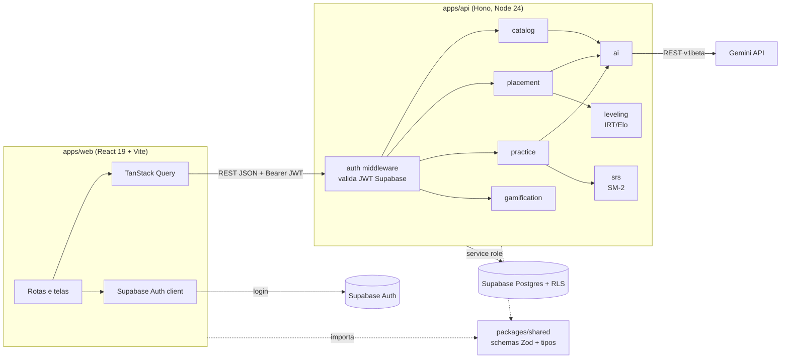
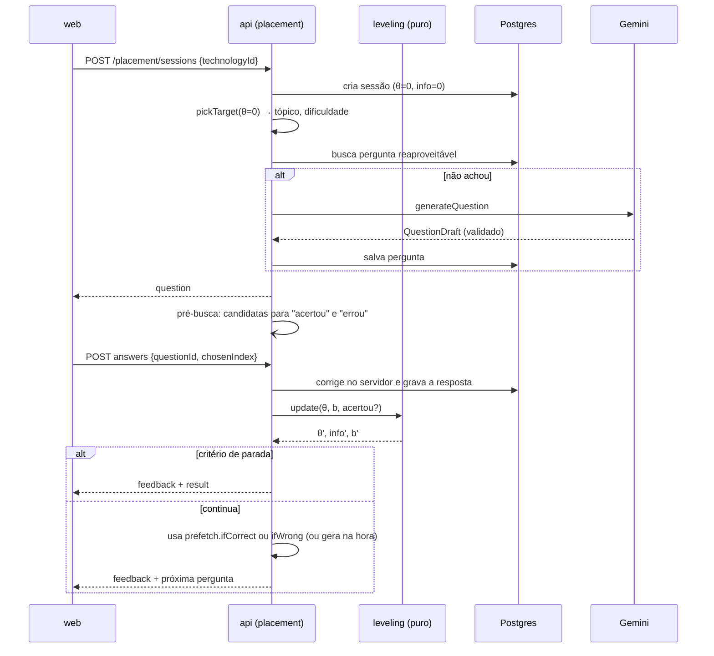

# SkillQuest — Arquitetura

> Status: rascunho v0.1 (2026-11-19). Os requisitos (RF/RNF) estão em [PRD.md](./PRD.md).

## 1. Módulos



- **apps/web:** só UI. Usa o Supabase **apenas para autenticar** e manda o access token como `Authorization: Bearer` para a api. Todo dado de domínio passa pela api, nunca por leitura direta do banco, porque as tabelas de perguntas guardam a resposta correta (RNF-04).
- **apps/api:** a única camada com segredos (chave do Gemini e service role do Supabase). Roda como **Vercel Functions** (runtime Node, ver §9), então é **stateless**: nenhum estado fica em memória entre requisições; tudo que precisa sobreviver (θ, pré-busca, vidas) vai para o Postgres. Os módulos são pastas em `src/modules/*`, cada uma com as próprias rotas, o serviço e o repositório. `leveling` e `srs` são funções puras, sem I/O, fáceis de testar.
- **packages/shared:** a fonte única dos contratos. Os schemas Zod de requisição e resposta de cada endpoint e o schema da saída da IA ficam aqui, e os tipos TS são derivados com `z.infer`.

## 2. Camada de IA

```ts
// apps/api/src/modules/ai/types.ts (contrato; a implementação vem depois)
interface QuestionGenerator {
  classifyTechnology(input: string): Promise<TechClassification>;   // RF-02
  generateTopics(tech: Technology): Promise<TopicDraft[]>;          // RF-03
  generateQuestion(req: {
    tech: Technology; topic: Topic; difficulty: 1 | 2 | 3 | 4 | 5;
    avoidStems: string[];                                           // evita repetir o que o usuário já viu
  }): Promise<QuestionDraft>;
}
```

Há dois adaptadores, e a variável `AI_PROVIDER` escolhe qual entra:

| Adaptador | Uso |
|---|---|
| `GeminiRestGenerator` | Produção. `POST https://generativelanguage.googleapis.com/v1beta/models/${GEMINI_MODEL}:generateContent`, com a chave no header `x-goog-api-key` e `generationConfig.responseMimeType = "application/json"` mais o schema da resposta. O texto vem em `candidates[0].content.parts[0].text`. |
| `MockGenerator` | Dev, testes (com MSW interceptando a URL do Gemini) e o modo demo (RF-13). Lê fixtures em `apps/api/fixtures/`. |

> ⚠️ Confirme na documentação oficial da Gemini API, antes de implementar: o nome exato do modelo (`gemini-3.8-flash`, informado pelo usuário e ainda não verificado), os nomes atuais dos campos de JSON schema em `generationConfig` e os limites do plano gratuito (requisições por minuto e por dia).

### Pipeline de uma geração

1. **Montar o prompt:** instruções fixas e, em seguida, os dados variáveis num bloco delimitado (`<tecnologia>…</tecnologia>`). O prompt pede pt-BR, 4 opções, exatamente 1 correta, explicação de até 2 frases e a dificuldade estimada de 1 a 5.
2. **Chamar o Gemini** com timeout de 15s. Esse timeout, somado à nova tentativa do passo 5, precisa caber na duração máxima de função do plano Vercel em uso (§9).
3. `JSON.parse` e depois `QuestionDraftSchema.safeParse` (de `packages/shared`).
4. **Checagens semânticas:** as 4 opções são distintas (normalizadas), `correctIndex` fica entre 0 e 3, o enunciado e a explicação não estão vazios, e o enunciado não repete nenhum dos `avoidStems`.
5. Se falhar, faz **1 nova tentativa**, incluindo o motivo da falha no prompt. Se falhar de novo, devolve `AI_INVALID_RESPONSE`.
6. HTTP 429 ou erro de cota viram `AI_QUOTA_EXCEEDED` (RNF-06). Nesse caso, o serviço tenta reaproveitar uma pergunta salva antes de devolver o erro.

**Entrada livre (RF-02):** `trim`, minúsculas, até 40 caracteres, só `[a-z0-9 .+#-]`. O texto é procurado primeiro em `technologies.slug` e em `technologies.aliases`. Só se não estiver lá, chama `classifyTechnology`, que devolve `{ isTechnology, canonicalName, slug, aliases }`. Se `isTechnology` for falso, a api devolve `NOT_A_TECHNOLOGY`.

## 3. Modelo de dados (Postgres / Supabase)

Todas as tabelas têm RLS habilitado. A api acessa o banco com a service role e **sempre** filtra pelo `user_id` tirado do JWT validado. As políticas RLS existem para bloquear o acesso direto de clientes com a anon key.

| Tabela | Colunas principais | RLS (clientes autenticados) |
|---|---|---|
| `profiles` | `id` (PK = `auth.users.id`), `display_name`, `timezone` (IANA), `created_at` | select e update do próprio registro |
| `technologies` | `id`, `slug` (unique), `name`, `aliases text[]`, `created_at` | select para todos os autenticados |
| `topics` | `id`, `technology_id` (FK), `slug`, `name`, `position`; unique(`technology_id`, `slug`) | select para todos os autenticados |
| `questions` | `id`, `technology_id`, `topic_id`, `stem`, `options jsonb` (4 strings), `correct_index smallint`, `explanation`, `difficulty_ai smallint` (1–5), `difficulty_b real`, `times_answered int`, `times_correct int`, `reports int`, `status` (`active` / `retired`), `model`, `created_at` | **nenhum acesso** (só a service role) |
| `placement_sessions` | `id`, `user_id`, `technology_id`, `status` (`active` / `finished` / `abandoned`), `theta real`, `info real` (informação acumulada), `current_question_id`, `prefetch jsonb` (`{ ifCorrect, ifWrong }` → ids de pergunta), `started_at`, `finished_at` | select dos próprios |
| `answers` | `id`, `user_id`, `question_id`, `context` (`placement` / `practice`), `session_id`, `chosen_index`, `is_correct`, `theta_before`, `answered_at` | select dos próprios |
| `skill_estimates` | PK(`user_id`, `technology_id`, `topic_id` nullable → `NULL` = nível geral), `theta`, `info`, `answers_count`, `updated_at` | select dos próprios |
| `review_items` | PK(`user_id`, `question_id`), `ease real` (padrão 2.5), `interval_days int`, `repetitions int`, `due_at timestamptz` | select dos próprios |
| `xp_events` | `id`, `user_id`, `amount`, `reason` (`answer` / `session_complete` / `placement`), `ref_id`, `created_at` | select dos próprios |
| `user_stats` | PK `user_id`, `xp_total`, `streak_current`, `streak_best`, `last_active_date date`, `lives smallint`, `lives_updated_at` | select dos próprios |

Índices: `questions(technology_id, topic_id, status, difficulty_b)` para reaproveitar perguntas (§5), e `review_items(user_id, due_at)` para a prática.

As migrations ficam em `supabase/migrations/`.

## 4. Contratos de API

Base: `/api/v1`. Todas as rotas exigem `Authorization: Bearer <supabase access token>`. Os corpos são validados com os schemas de `packages/shared`.

**Uma pergunta, como o cliente a recebe** (sem a resposta correta):

```ts
type QuestionDTO = { id: string; topic: { slug: string; name: string }; stem: string; options: [string, string, string, string]; difficulty: 1|2|3|4|5 };
type AnswerFeedback = { correct: boolean; correctIndex: number; explanation: string };
```

| Método e rota | Requisição | Resposta 200 |
|---|---|---|
| `POST /technologies/resolve` | `{ input: string }` | `{ technology: { id, slug, name }, topics: { slug, name }[] }` (gera os tópicos se a tecnologia for nova) |
| `POST /placement/sessions` | `{ technologyId }` | `{ sessionId, question: QuestionDTO, progress: { answered: 0, max: 20 } }` |
| `POST /placement/sessions/:id/answers` | `{ questionId, chosenIndex }` | `{ feedback: AnswerFeedback, next: { question: QuestionDTO } \| { result: PlacementResult }, progress }` |
| `GET /practice/today?technologyId=` | — | `{ sessionId, questions: QuestionDTO[] (≈10), lives, livesRefillAt }` |
| `POST /practice/answers` | `{ sessionId, questionId, chosenIndex }` | `{ feedback: AnswerFeedback, xpGained, lives, sessionComplete: boolean }` |
| `GET /me/progress` | — | `{ xpTotal, streak: { current, best }, lives, technologies: { id, name, level, theta, topics: { slug, name, level }[] }[] }` |
| `POST /questions/:id/report` | `{ reason: string }` | `204` |

```ts
type PlacementResult = { level: Level; theta: number; topics: { slug: string; name: string; level: Level; strength: "forte" | "fraco" | "neutro" }[] };
type Level = "iniciante" | "basico" | "intermediario" | "avancado" | "especialista";
```

**Formato de erro** (4xx e 5xx): `{ error: { code: ErrorCode, message: string } }`. Os códigos possíveis são:
- `UNAUTHORIZED` (401)
- `VALIDATION_ERROR` (400)
- `NOT_FOUND` (404)
- `NOT_A_TECHNOLOGY` (422)
- `NO_LIVES` (409)
- `PLACEMENT_COOLDOWN` (409, RF-12)
- `AI_QUOTA_EXCEEDED` (503, com `retryAfterSeconds`)
- `AI_INVALID_RESPONSE` (502)

## 5. Fluxo do quiz adaptativo



- **`pickTarget(θ, sessão)`:** o tópico é o que tem menos respostas nesta sessão (empate desempatado pela ordem dos tópicos). A dificuldade alvo é `clamp(round(θ) + 3, 1, 5)`.
- **Reaproveitar uma pergunta:** `status = active`, mesmo tópico, `|difficulty_b − θ| ≤ 0,5`, e o usuário nunca a respondeu. Se houver várias, escolhe aleatoriamente entre elas. Se não houver, gera uma nova (geração em tempo real).
- **Pré-busca:** logo depois de enviar uma pergunta, a api calcula θ para os casos "acertou" e "errou", prepara uma pergunta para cada (reaproveitando ou gerando) e grava os ids em `placement_sessions.prefetch`. Quando a resposta chega, a pergunta seguinte já está pronta. Se a pré-busca não terminou a tempo, gera na hora. Cada pergunta gasta até 2 gerações; entra no cálculo da cota.
  - Na Vercel, a função pode ser congelada assim que a resposta sai. Por isso, a pré-busca é registrada com `waitUntil` (pacote `@vercel/functions`), que mantém a função viva até a promise terminar, dentro da duração máxima. Uma promise solta, sem `waitUntil`, pode simplesmente não rodar.
  - Como o resultado vai para o banco, a próxima requisição pode cair em outra instância da função e ainda assim encontrar a pergunta pronta.

## 6. Algoritmo de nível (IRT 1PL / Elo)

Habilidade do usuário (θ) e dificuldade da pergunta (b) ficam na mesma escala logit, por volta de −3 a +3.

```
P(acerto)  = 1 / (1 + e^-(θ − b))
θ'         = θ + K_n · (r − P)          r = 1 se acertou, 0 se errou
K_n        = max(0,3; 0,8 · 0,9^n)      n = respostas já dadas na sessão
info'      = info + P · (1 − P)         informação de Fisher (1PL)
SE         = 1 / √info
```

- **b inicial** vem da dificuldade estimada pela IA: 1 → −2, 2 → −1, 3 → 0, 4 → +1, 5 → +2.
- **Recalibrar b:** depois que a pergunta tem pelo menos 5 respostas, cada nova resposta faz `b' = b − K_q · (r − P)`, com `K_q = 0,05`. Acertos inesperados baixam b, erros inesperados sobem.
- **Parada:** no mínimo 8 perguntas e `SE < 0,6`, ou no máximo 20. Com P ≈ 0,5, cada pergunta soma cerca de 0,25 de informação, então `SE < 0,6` (info > 2,78) costuma ser atingido por volta da 11ª pergunta, dentro da meta de ≤ 14 do PRD. Ajuste o limiar com os dados reais.
- **θ por tópico:** além do θ geral, cada tópico tem a própria estimativa em `skill_estimates`, atualizada com a mesma regra a partir de θ_tópico = θ geral no momento da primeira resposta do tópico. Um tópico é "forte" se θ_tópico ≥ θ + 0,5, "fraco" se θ_tópico ≤ θ − 0,5, e "neutro" no resto ou com menos de 2 respostas.
- **θ vira nível:**

  | Faixa de θ | Nível |
  |---|---|
  | θ < −1,5 | iniciante |
  | −1,5 ≤ θ < −0,5 | básico |
  | −0,5 ≤ θ < 0,5 | intermediário |
  | 0,5 ≤ θ < 1,5 | avançado |
  | θ ≥ 1,5 | especialista |

  O θ geral também é atualizado na prática diária, com K fixo de 0,3, para o nível evoluir.

**Exemplo:**

| Passo | θ | b | P | resultado | K | θ' |
|---|---|---|---|---|---|---|
| 1 | 0 | 0 (dif. 3) | 0,50 | acertou | 0,80 | 0 + 0,8·0,5 = **0,40** |
| 2 | 0,40 | 0 (dif. 3) | 0,60 | errou | 0,72 | 0,40 − 0,72·0,60 = **−0,03** |
| 3 | −0,03 | 0 (dif. 3) | 0,49 | acertou | 0,65 | −0,03 + 0,65·0,51 = **0,30** |

## 7. Prática diária e gamificação

**Composição da sessão** (`GET /practice/today`, cerca de 10 perguntas):
- até 6 perguntas de `review_items` vencidos (`due_at ≤ agora`), as mais atrasadas primeiro;
- o resto vem dos 2 tópicos com menor θ_tópico, na dificuldade alvo `clamp(round(θ_tópico) + 3, 1, 5)`, reaproveitando ou gerando como no §5.

**SM-2 simplificado:** cada resposta na prática, e cada erro no nivelamento, cria ou atualiza um `review_item`. A qualidade é q = 4 no acerto e q = 1 no erro.
- **Erro:** `repetitions = 0` e `interval = 1` dia.
- **Acerto:** `repetitions += 1`. O intervalo fica em 1 dia na 1ª repetição, 3 dias na 2ª, e depois `round(interval · ease)`.
- **Ease:** `ease = max(1,3; ease + 0,1 − (5 − q)·(0,08 + (5 − q)·0,02))`.
- **Próxima revisão:** `due_at = agora + interval`.

**Regras de gamificação:**

| Regra | Detalhe |
|---|---|
| XP | acerto: `10 + 2·(dificuldade − 1)`; sessão de prática completa: +20; nivelamento concluído: +30. Cada ganho vira uma linha em `xp_events` e soma em `user_stats.xp_total`. |
| Streak | ao completar uma sessão, calcula `hoje` no `profiles.timezone`. Se `last_active_date = hoje`, não muda nada; se for ontem, `streak_current += 1`; senão, volta a 1. Atualiza `streak_best`. |
| Vidas | calculadas na leitura: `vidas = min(5, lives + floor((agora − lives_updated_at) / 4h))`. Um erro na prática persiste o valor recalculado − 1. Com 0 vidas, `POST /practice/answers` devolve `NO_LIVES`, junto com `livesRefillAt`. |

## 8. Ambientes, configuração e testes

| Variável (apps/api/.env) | Descrição |
|---|---|
| `AI_PROVIDER` | `gemini` ou `mock` (padrão `mock` em dev e nos testes) |
| `GEMINI_API_KEY` | chave do plano gratuito, só no servidor |
| `GEMINI_MODEL` | padrão `gemini-3.8-flash` (confirme o nome, §2) |
| `SUPABASE_URL`, `SUPABASE_SERVICE_ROLE_KEY`, `SUPABASE_JWT_SECRET` (ou JWKS) | acesso ao banco e validação do JWT |
| `DEMO_MODE` | `true` usa o `MockGenerator` e um usuário demo (RF-13) |

O apps/web só recebe `VITE_SUPABASE_URL` e `VITE_SUPABASE_ANON_KEY`. A api é chamada pelo caminho relativo `/api/v1` (ver §9), então não precisa de `VITE_API_URL` em produção; em dev, o proxy do Vite aponta `/api` para a api local.

Em produção, as variáveis ficam nas Environment Variables de cada projeto Vercel, nunca em arquivo commitado.

**Testes:**

| Camada | Ferramenta | O que cobre |
|---|---|---|
| Unidade | Vitest | `leveling` e `srs` (funções puras, com casos numéricos como os do §6), validadores da saída da IA, regras de XP, streak e vidas |
| Integração da api | Vitest + MSW | MSW intercepta `generativelanguage.googleapis.com` e devolve respostas válidas, inválidas e 429, para exercitar o pipeline do §2 |
| Componente | Vitest + Testing Library | telas do quiz e da prática |
| E2E | Playwright | fluxo completo com `AI_PROVIDER=mock`: login, resolver tecnologia, nivelamento, resultado, prática |

Nenhum teste chama a API real do Gemini.

## 9. Deploy (Vercel)

Um repositório só, com **dois projetos Vercel**, cada um com seu Root Directory:

| Projeto Vercel | Root Directory | O que publica |
|---|---|---|
| `skillquest-web` | `apps/web` | build estático do Vite (SPA) |
| `skillquest-api` | `apps/api` | app Hono como Vercel Functions, runtime **Node** (não Edge) |

- **Mesma origem:** o `vercel.json` do web reescreve `/api/*` para o domínio do projeto api. O navegador só fala com um domínio, então não há CORS para configurar, e a SPA também reescreve as outras rotas para `index.html`.
- **pnpm workspace:** cada projeto instala a partir da raiz do monorepo para enxergar `packages/shared`. Confirme as opções de monorepo da Vercel (instalar na raiz, Root Directory por projeto) ao criar os projetos.
- **Banco em ambiente serverless:** cada invocação pode abrir uma conexão nova, então a api fala com o Supabase por `supabase-js` (HTTP, via PostgREST) e não abre pool `pg` direto. Se algum dia precisar de SQL direto, use o pooler de conexões do Supabase.
- **Sem estado em memória:** nada de cache ou rate limit em variável de módulo; essas coisas vão para o Postgres (ou ficam de fora no MVP).
- **Preview deploys:** cada PR ganha uma URL de preview. Configure `AI_PROVIDER=mock` no ambiente Preview para os previews não gastarem a cota do Gemini; só o ambiente Production usa `gemini`.

> ⚠️ Confirme na documentação da Vercel, para o plano Hobby (gratuito, uso pessoal e não comercial, o que cabe num portfólio):
> - a duração máxima de uma função, que precisa acomodar a geração (§2) e a pré-busca com `waitUntil` (§5);
> - as versões de Node disponíveis (o projeto assume Node 24);
> - os limites mensais de invocações e de tráfego.
