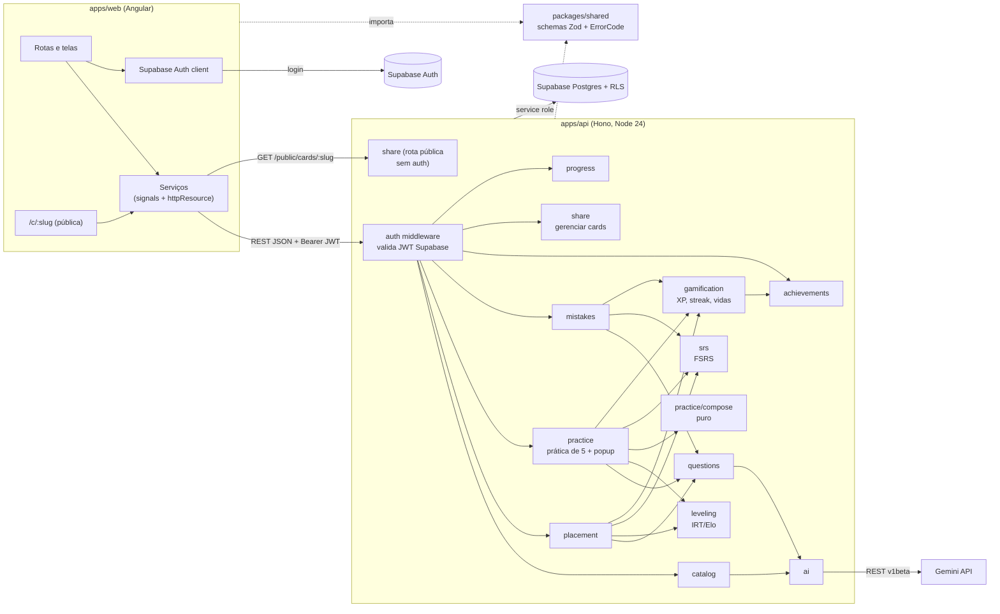
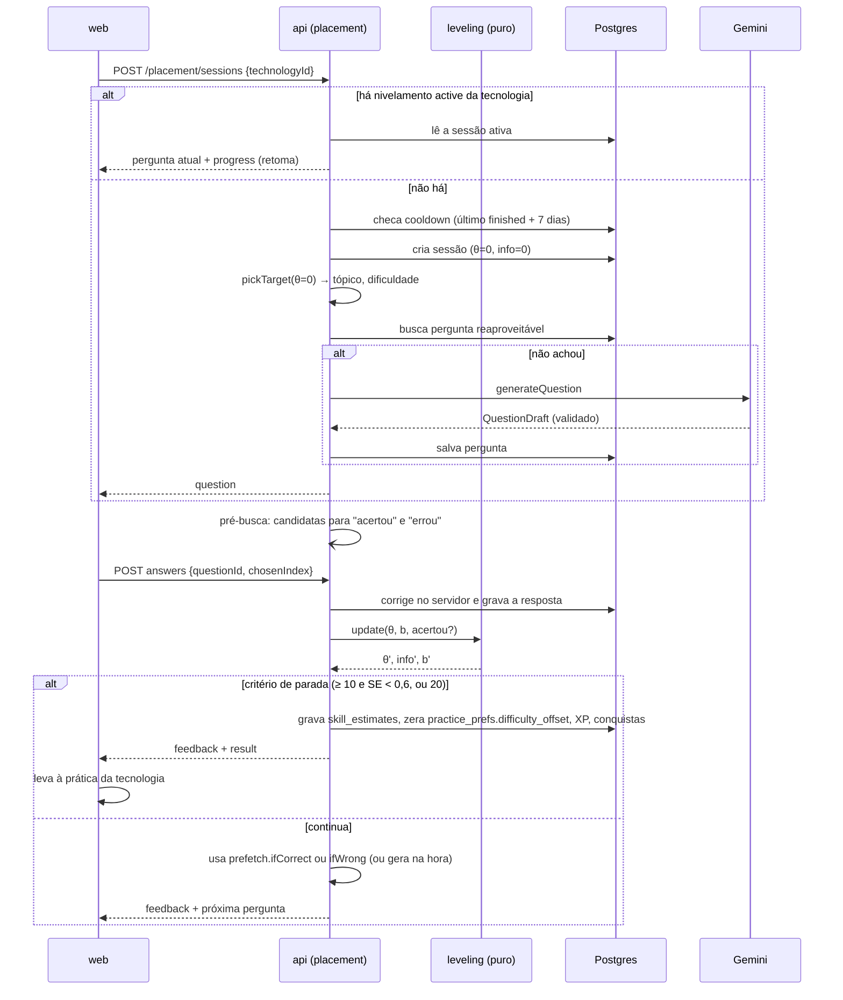

# SkillQuest — Arquitetura

> Status: rascunho v0.4 (2026-11-25). Os requisitos (RF/RNF) estão em [PRD.md](./PRD.md) (v0.3).
>
> **v0.4 (mudança de escopo, [ADR 0004](./ADR/0004-quiz-sem-trilha.md)):** saem a trilha, as unidades e as lições: o módulo `path` (`path/build.ts`), as tabelas `units` e `lessons`, as rotas `GET /paths/:technologyId`, `POST /lessons/:lessonId/sessions` e `POST /lessons/sessions/:sessionId/answers`, o `ErrorCode` `LESSON_LOCKED`, `kind = lesson` em `study_sessions`, `context = lesson` em `answers`, `PathDTO` e `LessonResult`. Entram a **prática de 5 perguntas** (§7.3, rotas em §4.1) e o **popup "Como foi?"** (RF-24, §3.3, §4.1 e §7.3). O nivelamento passa a ter mínimo de 10 perguntas (§6) e, ao concluir, leva à prática (§5).
>
> Ajustes da v0.4 vindos do plano das telas ([docs/plans/telas-fluxo-principal.md](./plans/telas-fluxo-principal.md)):
> - `POST /placement/sessions` retoma o nivelamento ativo;
> - a pergunta da prática sai como `PracticeQuestionDTO`, com `source`, e toda pergunta traz `reportedByMe` (§4);
> - `PLACEMENT_COOLDOWN` inclui `retryAfterSeconds` (§4.6);
> - `PracticeSummaryDTO` ganha `placementAvailableAt`;
> - `GET /me/progress` lista também tecnologias com nivelamento em andamento, ordenadas pela atividade mais recente;
> - o report passa a ter motivo fixo e a ser idempotente por usuário, com a tabela nova `question_reports` (§3.3, §4.1).
>
> v0.3: o `apps/web` passa de React para Angular (última estável), com Angular CDK + Tailwind e signals; ver [ADR 0002](./ADR/0002-angular-em-vez-de-react.md).
>
> A numeração das seções §1 a §10 foi preservada porque as rules (`.claude/rules/*.md`) e o PRD citam §2, §5, §6 e §7. Seções removidas ficam só com o título.

## 0. Estrutura do monorepo

pnpm workspace (`pnpm-workspace.yaml` com `apps/*` e `packages/*`):

```
skillquest/
├─ pnpm-workspace.yaml
├─ package.json                 # scripts: dev, test, e2e, typecheck, lint
├─ apps/
│  ├─ web/                      # Angular (última estável) + Angular CDK + Tailwind (SPA, zoneless)
│  │  ├─ angular.json           # builders @angular/build:application e :unit-test (Vitest)
│  │  ├─ proxy.conf.json        # dev: ng serve encaminha /api para a api local
│  │  ├─ vercel.json            # rewrite /api/* → projeto api; SPA → index.html
│  │  └─ src/app/
│  │     ├─ app.config.ts       # provideZonelessChangeDetection, provideRouter, provideHttpClient
│  │     ├─ app.routes.ts       # rotas lazy (loadComponent): login, catálogo, nivelamento,
│  │     │                      #   prática (com o popup "Como foi?"), revisão de erros,
│  │     │                      #   progresso, conquistas, cards, /c/:slug (pública, sem authGuard)
│  │     ├─ features/<feature>/ # componentes standalone + serviços (signals, httpResource)
│  │     ├─ shared/ui/          # componentes próprios (Tailwind + Angular CDK)
│  │     └─ core/               # cliente da api tipado, interceptor de auth, supabase auth, authGuard
│  └─ api/                      # Hono, Node 24, Vercel Functions
│     ├─ api/index.ts           # entrada da Vercel Function (adapta o app Hono) — confirme o formato na doc da Vercel
│     ├─ src/
│     │  ├─ app.ts              # monta o Hono, middleware de auth, app.onError
│     │  ├─ middleware/auth.ts  # valida o JWT do Supabase, põe userId no contexto
│     │  ├─ lib/                # supabase-js (service role), clock (now), errors
│     │  └─ modules/
│     │     ├─ ai/              # QuestionGenerator, adaptadores, pipeline de validação
│     │     │  ├─ types.ts
│     │     │  ├─ gemini-rest.ts   # GeminiRestGenerator (único que conhece a URL do Gemini)
│     │     │  ├─ mock.ts          # MockGenerator (lê fixtures)
│     │     │  ├─ validate.ts      # Zod + checagens semânticas
│     │     │  ├─ usage.repo.ts    # contador diário por usuário (RNF-11)
│     │     │  └─ prompts/         # prompts versionados: classify.v1.ts, topics.v1.ts, question.v1.ts
│     │     ├─ catalog/         # routes.ts, service.ts, repo.ts (tecnologias e tópicos)
│     │     ├─ questions/       # repo.ts (reuso, salvar, b), toQuestionDTO(), report
│     │     ├─ placement/       # routes.ts, service.ts, repo.ts
│     │     ├─ leveling/        # irt.ts (puro: P, update, SE, parada, nível)
│     │     ├─ practice/        # prática de 5 + popup: routes.ts, service.ts, repo.ts,
│     │     │                   #   compose.ts (puro: slots, dificuldade-alvo e offset, §7.3)
│     │     ├─ srs/             # fsrs.ts (toRating + wrapper do ts-fsrs, puro)
│     │     ├─ mistakes/        # revisão de erros: routes.ts, service.ts, repo.ts
│     │     ├─ gamification/    # rules.ts (puro: XP, streak, vidas), service.ts, repo.ts
│     │     ├─ achievements/    # rules.ts (puro), routes.ts, service.ts, repo.ts
│     │     ├─ share/           # cards: routes.ts (privadas + pública), service.ts, repo.ts
│     │     └─ progress/        # GET /me/progress: routes.ts, service.ts, repo.ts
│     ├─ fixtures/              # perguntas/tópicos prontos p/ MockGenerator, demo e E2E
│     └─ evals/                 # avaliação offline dos prompts (casos + script), nunca roda no CI com IA real
├─ packages/
│  └─ shared/
│     └─ src/
│        ├─ errors.ts           # enum ErrorCode + status HTTP de cada código
│        ├─ constants.ts        # constantes do nivelamento e da prática (§6, §7.3), vidas, XP
│        ├─ schemas/            # Zod por domínio: catalog, placement, practice, questions,
│        │                      #   mistakes, achievements, share, progress, ai (QuestionDraft…)
│        └─ index.ts            # reexporta schemas e tipos (z.infer)
├─ supabase/
│  ├─ migrations/               # SQL versionado (tabelas, RLS, índices, RPCs, seed de achievements)
│  └─ seed.sql                  # dados locais/demo (opcional)
├─ e2e/                         # Playwright *.spec.ts (AI_PROVIDER=mock)
├─ scripts/harness/             # verify, check-arch, check-bundle (+ testes) — ADR 0003
├─ .github/workflows/ci.yml     # pnpm verify + commitlint em PR e push para main
└─ docs/                        # PRD, ARCHITECTURE, ADR/, plans/
```

Regras de dependência:
- `routes.ts` valida a entrada com schemas de `packages/shared` e chama o `service.ts`; nunca acessa o banco.
- `service.ts` tem a regra de negócio e orquestra repos, módulos puros e a IA (só via `QuestionGenerator`).
- `repo.ts` só fala com o Supabase e **sempre** filtra por `user_id` em tabelas do usuário; sem regra de negócio.
- Módulos puros (`leveling`, `srs`, `practice/compose.ts`, `gamification/rules.ts`, `achievements/rules.ts`) não fazem I/O e recebem `now` por parâmetro.
- Testes ficam ao lado do código (`foo.ts` → `foo.test.ts`); E2E em `e2e/`.

## 1. Módulos



- **apps/web:** só UI. Usa o Supabase **apenas para autenticar** e manda o access token como `Authorization: Bearer` para a api. Todo dado de domínio passa pela api, nunca por leitura direta do banco, porque as tabelas de perguntas guardam a resposta correta (RNF-04). A página `/c/:slug` é a única tela sem login e chama a única rota sem auth.
- **apps/api:** a única camada com segredos (chave do Gemini e service role do Supabase). Roda como **Vercel Functions** (runtime Node, ver §9), então é **stateless**: nenhum estado fica em memória entre requisições; tudo que precisa sobreviver (θ, pré-busca, vidas, sessões, ajuste do popup, contadores de uso) vai para o Postgres. Os módulos são pastas em `src/modules/*`, cada uma com as próprias rotas, o serviço e o repositório (§0). `leveling`, `srs`, `practice/compose`, `gamification/rules` e `achievements/rules` são funções puras, sem I/O, fáceis de testar.
- **packages/shared:** a fonte única dos contratos. Os schemas Zod de requisição e resposta de cada endpoint, o schema da saída da IA e o enum `ErrorCode` ficam aqui, e os tipos TS são derivados com `z.infer`.
- **questions** concentra o que todos os modos usam: buscar pergunta reaproveitável, gerar via `ai` quando precisar, salvar, recalibrar `b`, `toQuestionDTO()` e o report.

## 2. Camada de IA

```ts
// apps/api/src/modules/ai/types.ts (contrato; a implementação vem depois)
interface QuestionGenerator {
  classifyTechnology(input: string): Promise<TechClassification>;   // RF-02
  generateTopics(tech: Technology): Promise<TopicDraft[]>;          // RF-03
  generateQuestion(req: {
    tech: Technology; topic: Topic; difficulty: 1 | 2 | 3 | 4 | 5;
    avoidStems: string[];                                           // evita repetir o que o usuário já viu
  }): Promise<QuestionDraft>;
}
```

Há dois adaptadores, e a variável `AI_PROVIDER` escolhe qual entra:

| Adaptador | Uso |
|---|---|
| `GeminiRestGenerator` | Produção. `POST https://generativelanguage.googleapis.com/v1beta/models/${GEMINI_MODEL}:generateContent`, com a chave no header `x-goog-api-key` e `generationConfig.responseMimeType = "application/json"` mais o schema da resposta. O texto vem em `candidates[0].content.parts[0].text`. |
| `MockGenerator` | Dev, testes (com MSW interceptando a URL do Gemini) e o modo demo (RF-13). Lê fixtures em `apps/api/fixtures/`. |

> ⚠️ Confirme na documentação oficial da Gemini API, antes de implementar: o nome exato do modelo (`gemini-3.8-flash`, informado pelo usuário e ainda não verificado), os nomes atuais dos campos de JSON schema em `generationConfig` e os limites do plano gratuito (requisições por minuto e por dia).

**Prompts versionados:** cada prompt é um módulo em `apps/api/src/modules/ai/prompts/` com nome `<tarefa>.v<N>.ts` (`classify.v1.ts`, `topics.v1.ts`, `question.v1.ts`). Mudança de texto que altere o comportamento cria `v<N+1>`; a pergunta salva guarda `model` e `prompt_version`. Os casos de avaliação ficam em `apps/api/evals/` e rodam manualmente (fora do CI) contra o Gemini real, para comparar versões.

### Pipeline de uma geração

1. **Montar o prompt:** instruções fixas e, em seguida, os dados variáveis num bloco delimitado (`<tecnologia>…</tecnologia>`). O prompt pede pt-BR, 4 opções, exatamente 1 correta, explicação de até 2 frases e a dificuldade estimada de 1 a 5.
2. **Chamar o Gemini** com timeout de 15s. Esse timeout, somado à nova tentativa do passo 5, precisa caber na duração máxima de função do plano Vercel em uso (§9).
3. `JSON.parse` e depois `QuestionDraftSchema.safeParse` (de `packages/shared`).
4. **Checagens semânticas:** as 4 opções são distintas (normalizadas), `correctIndex` fica entre 0 e 3, o enunciado e a explicação não estão vazios, e o enunciado não repete nenhum dos `avoidStems`.
5. Se falhar, faz **1 nova tentativa**, incluindo o motivo da falha no prompt. Se falhar de novo, devolve `AI_INVALID_RESPONSE`.
6. HTTP 429 ou erro de cota viram `AI_QUOTA_EXCEEDED` (RNF-06). Nesse caso, o serviço tenta reaproveitar uma pergunta salva antes de devolver o erro.

**Limite por usuário (RNF-11):** antes de cada `generateQuestion` (incluindo a pré-busca do nivelamento e da prática), `ai/usage.repo.ts` incrementa atomicamente `ai_usage_daily(user_id, day)` (RPC SQL `increment_ai_usage`, que devolve o novo valor). Acima de `AI_DAILY_LIMIT_PER_USER` (padrão 100), não gera: o serviço tenta reaproveitar uma pergunta salva com a dificuldade mais próxima e, se não houver, devolve `RATE_LIMITED`. A pré-busca simplesmente não acontece quando o limite estourou.

**Entrada livre (RF-02):** `trim`, minúsculas, até 40 caracteres, só `[a-z0-9 .+#-]`. O texto é procurado primeiro em `technologies.slug` e em `technologies.aliases`. Só se não estiver lá, chama `classifyTechnology`, que devolve `{ isTechnology, canonicalName, slug, aliases }`. Se `isTechnology` for falso, a api devolve `NOT_A_TECHNOLOGY`.

## 3. Modelo de dados (Postgres / Supabase)

Todas as tabelas têm RLS habilitado. A api acessa o banco com a service role e **sempre** filtra pelo `user_id` tirado do JWT validado. As políticas RLS existem para bloquear o acesso direto de clientes com a anon key. "Nenhum acesso" significa RLS ligado e nenhuma política para `anon` nem `authenticated`.

> Nenhuma migration foi aplicada até a v0.4, então as tabelas removidas simplesmente não são criadas.

### 3.1 Tabelas existentes (v0.1, com acréscimos)

| Tabela | Colunas principais | RLS (clientes autenticados) |
|---|---|---|
| `profiles` | `id` (PK = `auth.users.id`), `display_name`, `timezone` (IANA), `created_at` | select e update do próprio registro |
| `technologies` | `id`, `slug` (unique), `name`, `aliases text[]`, `created_at` | select para todos os autenticados |
| `topics` | `id`, `technology_id` (FK), `slug`, `name`, `position`; unique(`technology_id`, `slug`) | select para todos os autenticados |
| `questions` | `id`, `technology_id`, `topic_id`, `stem`, `options jsonb` (4 strings), `correct_index smallint`, `explanation`, `difficulty_ai smallint` (1–5), `difficulty_b real`, `times_answered int`, `times_correct int`, `reports int` (número de **usuários distintos** que reportaram, mantido a partir de `question_reports`, §3.3), `status` (`active` / `retired`; vira `retired` quando `reports` chega a 3), `model`, `prompt_version text`, `created_at` | **nenhum acesso** (só a service role) |
| `placement_sessions` | `id`, `user_id`, `technology_id`, `status` (`active` / `finished` / `abandoned`), `theta real`, `info real` (informação acumulada), `current_question_id`, `current_served_at timestamptz` (quando a pergunta atual foi entregue), `prefetch jsonb` (`{ ifCorrect, ifWrong }` → ids de pergunta), `started_at`, `finished_at` | select dos próprios |
| `answers` | `id`, `user_id`, `question_id`, `context` (`placement` / `practice` / `mistakes`; **`lesson` removido na v0.4**), `session_id` (de `placement_sessions` ou `study_sessions`, conforme `context`), `chosen_index`, `is_correct`, `hint_used bool` (padrão false), `response_ms int` (medido no servidor, §7.4), `theta_before`, `answered_at` | select dos próprios |
| `skill_estimates` | PK(`user_id`, `technology_id`, `topic_id` nullable → `NULL` = nível geral), `theta`, `info`, `answers_count`, `updated_at` | select dos próprios |
| `review_items` | PK(`user_id`, `question_id`); estado do cartão FSRS, espelhando o tipo `Card` do `ts-fsrs` na versão instalada (por exemplo `due timestamptz`, `stability real`, `difficulty real`, `elapsed_days int`, `scheduled_days int`, `reps int`, `lapses int`, `state smallint`, `last_review timestamptz`; confira os campos ao instalar, §7.4) | select dos próprios |
| `xp_events` | `id`, `user_id`, `amount`, `reason` (`answer` / `session_complete` / `placement`), `ref_id`, `created_at` | select dos próprios |
| `user_stats` | PK `user_id`, `xp_total`, `streak_current`, `streak_best`, `last_active_date date`, `lives smallint`, `lives_updated_at` | select dos próprios |

### 3.2 Tabelas da v0.2 (com mudanças da v0.4)

| Tabela | Colunas principais | RLS (clientes autenticados) |
|---|---|---|
| ~~`units`~~ | removida na v0.4 (ADR 0004) | — |
| ~~`lessons`~~ | removida na v0.4 (ADR 0004) | — |
| `study_sessions` | `id`, `user_id`, `technology_id`, `kind` (`practice` / `mistakes`; **`lesson` removido**), ~~`lesson_id`~~ (removida), `slots jsonb` (`[{ source: "review" \| "new", difficulty, topicId, questionId \| null, servedAt \| null, hintIndex \| null }]`; **`source` é novo**), `answered_count smallint`, `correct_count smallint`, `status` (`active` / `finished` / `abandoned`), **`feedback text` nullable** (`facil` / `na_medida` / `dificil`, só em `kind = practice`, gravado pelo popup, §7.3), `started_at`, `last_answer_at`, `finished_at` | select dos próprios |
| `achievements` | `id`, `slug` (unique), `name`, `description`, `icon`, `position`; seed por migration com as 8 do PRD §3.7 | select para todos os autenticados |
| `user_achievements` | PK(`user_id`, `achievement_id`), `unlocked_at`, `ref_id` (sessão que desbloqueou) | select dos próprios |
| `share_cards` | `id`, `user_id`, `technology_id`, `slug text` (unique; 16 caracteres base64url = 96 bits), `display_name` (2–30 caracteres, sem `@`), `active bool`, `views int` (padrão 0), `created_at`, `deactivated_at`; índice único parcial (`user_id`, `technology_id`) `where active` | **nenhum acesso** (nem para o dono; tudo via api) |
| `ai_usage_daily` | PK(`user_id`, `day date` em UTC), `generations int` | **nenhum acesso** |

### 3.3 Tabelas novas (v0.4)

| Tabela | Colunas principais | RLS (clientes autenticados) |
|---|---|---|
| `practice_prefs` | PK(`user_id`, `technology_id`), `difficulty_offset smallint` (padrão 0, `check` entre −2 e +2), `updated_at`. Guarda o ajuste do popup (RF-24), separado de θ | select dos próprios |
| `question_reports` | PK(`user_id`, `question_id`) (um report por usuário × pergunta), `reason text` (`check` em `resposta_errada` / `ambigua` / `mais_de_uma_correta` / `outro`), `details text` nullable (≤ 280 caracteres, `check`), `created_at`. Também é a fonte do `reportedByMe` do `QuestionDTO` (§4) | **nenhum acesso** (só a service role; o report é escrito e lido só pela api) |

`study_sessions` guarda as práticas (`kind = practice`) e as revisões de erros (`kind = mistakes`). Cada prática é uma linha.

Índices:
- `questions(technology_id, topic_id, status, difficulty_b)` para reaproveitar perguntas (§5, §7.3);
- `review_items(user_id, due)` para as revisões vencidas da prática;
- `answers(user_id, question_id, answered_at desc)` para a revisão de erros (última resposta por pergunta);
- `study_sessions(user_id, technology_id, kind, status)` para achar a sessão ativa;
- `placement_sessions(user_id, technology_id, status)` para achar o nivelamento ativo e o último concluído (§5, cooldown);
- a PK de `question_reports` (`user_id`, `question_id`) já atende a consulta do `reportedByMe`.

**Funções SQL (RPC)** chamadas via `supabase-js`, para operações atômicas sem pool `pg`:
- `increment_ai_usage(user_id, day)`;
- `increment_card_views(slug)`;
- `latest_wrong_questions(user_id, technology_id, limit)` (§7.5);
- `report_question(user_id, question_id, reason, details)`: numa transação, faz `insert … on conflict (user_id, question_id) do nothing` em `question_reports`. Um 2º report do mesmo usuário não soma e **mantém o 1º motivo e os 1ºs detalhes**. Só se a linha foi inserida, incrementa `questions.reports` e, ao chegar a 3, marca `status = retired`.

As migrations ficam em `supabase/migrations/`; o seed de `achievements` é uma migration própria.

## 4. Contratos de API

Base: `/api/v1`. Todas as rotas exigem `Authorization: Bearer <supabase access token>`, **exceto** `GET /public/cards/:slug`. Os corpos, query e params são validados com os schemas de `packages/shared`. Recurso de outro usuário responde `NOT_FOUND` (não revela que existe).

**Uma pergunta, como o cliente a recebe** (sem a resposta correta). Toda pergunta sai da api por `toQuestionDTO(question, { reportedByMe })` (em `modules/questions`), que remove `correct_index` e `explanation`:

```ts
type QuestionDTO = {
  id: string; topic: { slug: string; name: string }; stem: string;
  options: [string, string, string, string]; difficulty: 1|2|3|4|5;
  reportedByMe: boolean;   // o usuário do JWT já reportou esta pergunta (existe linha em question_reports)
};
// Na prática, a pergunta leva também a origem do slot (§7.3), para a tela mostrar o selo "Revisão".
// `source` diz só de onde veio a pergunta; não revela a resposta nem se o usuário errou antes.
type PracticeQuestionDTO = QuestionDTO & { source: "review" | "new" };
type AnswerFeedback = { correct: boolean; correctIndex: number; explanation: string };
type Progress = { answered: number; total: number };
```

- `QuestionDTOSchema` e `PracticeQuestionDTOSchema` (`QuestionDTOSchema.extend({ source }).strict()`) são `.strict()`: qualquer campo a mais, como `correctIndex`, quebra o parse.
- `reportedByMe` é calculado por usuário (consulta à PK de `question_reports`) e só diz respeito a quem pergunta. Nunca revela quantos ou quais outros usuários reportaram.

### 4.1 Catálogo, nivelamento, prática e progresso

| Método e rota | Requisição | Resposta 200 | Erros |
|---|---|---|---|
| `POST /technologies/resolve` | `{ input: string }` | `{ technology: { id, slug, name }, topics: { slug, name }[] }` (gera os tópicos se a tecnologia for nova) | `VALIDATION_ERROR`, `NOT_A_TECHNOLOGY`, `AI_*`, `RATE_LIMITED` |
| `POST /placement/sessions` | `{ technologyId }` | `{ sessionId, question: QuestionDTO, progress: { answered, total: 20 } }`. Se já há nivelamento `active` da tecnologia, **retoma** essa sessão e devolve a pergunta atual, com `answered` = respostas já dadas (§5). Senão, cria uma sessão com `answered: 0`. `total` é o máximo; o nivelamento pode parar a partir da 10ª (§6) | `NOT_FOUND`, `PLACEMENT_COOLDOWN` (com `retryAfterSeconds`), `AI_*`, `RATE_LIMITED` |
| `POST /placement/sessions/:id/answers` | `{ questionId, chosenIndex }` | `{ feedback, next: { question } \| { result: PlacementResult }, progress, newAchievements: AchievementDTO[] }` (**`pathUrl` removido**: a web leva à prática da tecnologia) | `NOT_FOUND`, `SESSION_FINISHED`, `VALIDATION_ERROR`, `AI_*` |
| `GET /practice/today?technologyId=` | — | `PracticeSummaryDTO` (abaixo; **substitui o `TodayDTO`**) | `PLACEMENT_REQUIRED`, `NOT_FOUND` |
| `POST /practice/sessions` | `{ technologyId }` | `{ sessionId, question: PracticeQuestionDTO, progress: { answered, total: 5 }, lives }`. Se já há prática `active` da tecnologia, retoma e devolve a pergunta atual (§7.3) | `PLACEMENT_REQUIRED`, `NOT_FOUND`, `NO_LIVES`, `AI_*`, `RATE_LIMITED` |
| `POST /practice/sessions/:sessionId/answers` | `{ questionId, chosenIndex }` (**substitui `POST /practice/answers`**) | `{ feedback, xpGained, lives, progress, next: { question: PracticeQuestionDTO } \| { result: PracticeResult }, newAchievements }` | `NO_LIVES`, `SESSION_FINISHED`, `VALIDATION_ERROR` (pergunta não é a atual), `NOT_FOUND`, `AI_*`, `RATE_LIMITED` |
| `POST /practice/sessions/:sessionId/feedback` | `PracticeFeedbackRequest` (abaixo) | `{ difficultyOffset: number }` | `NOT_FOUND` (sessão inexistente, de outro usuário ou `kind ≠ practice`), `VALIDATION_ERROR` (`rating` inválido ou sessão não `finished`) |
| `GET /me/progress` | — | `MeProgressResponse` (abaixo; **`unitsCompleted` e `unitsTotal` removidos**) | — |
| `POST /questions/:id/report` | `ReportQuestionRequest` (abaixo) | `204`, inclusive no 2º report do mesmo usuário (idempotente: não soma e mantém o 1º motivo) | `NOT_FOUND`, `VALIDATION_ERROR` |

```ts
type PlacementResult = { level: Level; theta: number; topics: { slug: string; name: string; level: Level; strength: "forte" | "fraco" | "neutro" }[] };
type Level = "iniciante" | "basico" | "intermediario" | "avancado" | "especialista";

type PracticeSummaryDTO = {
  activeSessionId: string | null;       // prática ativa da tecnologia, para o botão "continuar"
  dueReviews: number;                   // review_items vencidos da tecnologia (informativo)
  dailyGoalDone: boolean;               // last_active_date = hoje no fuso do usuário (§7.3)
  lives: number; livesRefillAt: string | null;
  placementAvailableAt: string | null;  // ISO: quando o nivelamento pode ser refeito (finished_at do último
                                        // concluído + 7 dias, RF-12); null = pode refazer já
};

type PracticeResult = { correctCount: number; total: 5; xpGained: number };   // xpGained = total da sessão

type MeProgressResponse = {
  xpTotal: number; streak: { current: number; best: number };
  lives: number; livesRefillAt: string | null; achievementsUnlocked: number;
  technologies: {                      // com ≥ 1 nivelamento concluído OU com nivelamento active,
                                       // ordenadas por lastActivityAt decrescente
    id: string; name: string;
    level: Level | null;               // do último nivelamento concluído; null se ainda não há
    theta: number | null;
    placementInProgress: boolean;      // há nivelamento active da tecnologia (inclusive um refazer em andamento)
    lastActivityAt: string;            // ISO: a mais recente entre a última resposta de prática ou de nivelamento
                                       // da tecnologia e o início do nivelamento ativo
    mistakesPending: number;
    topics: { slug: string; name: string; level: Level }[];   // vazio se não há nivelamento concluído
  }[];
};

const PracticeFeedbackRequestSchema = z.object({
  rating: z.enum(["facil", "na_medida", "dificil"]),
}).strict();

const ReportQuestionRequestSchema = z.object({
  reason: z.enum(["resposta_errada", "ambigua", "mais_de_uma_correta", "outro"]),
  details: z.string().trim().max(280).optional(),
}).strict();
```

**Rota do popup (RF-24):**
- Só aceita sessão `kind = practice` com `status = finished`. Grava `study_sessions.feedback` e aplica o deslocamento em `practice_prefs.difficulty_offset` (Fácil +1, Na medida 0, Difícil −1, limitado a −2..+2), na mesma requisição.
- **Idempotente:** se a sessão já tem `feedback`, não aplica de novo e devolve o `difficultyOffset` atual. Um feedback por prática.
- Não altera θ, `b`, XP, vidas nem streak.
- Fechar o popup sem responder não chama a rota: equivale a "Na medida" e nada é gravado.

**Rota do report (RF-25):**
- Chama a RPC `report_question` (§3): um report por usuário × pergunta, guardado em `question_reports`. Um 2º report do mesmo usuário não soma e mantém o 1º motivo. Só usuários distintos contam para os 3 que tiram a pergunta de circulação (`retired`).
- Depois do report, as próximas entregas da mesma pergunta àquele usuário vêm com `reportedByMe: true`.
- `NOT_FOUND` se a pergunta não existe. O texto de `details` é tratado como dado: não vai a prompt nem a log.

### 4.2 Trilha e lições — removida na v0.4 (ADR 0004)

As rotas `GET /paths/:technologyId`, `POST /lessons/:lessonId/sessions` e `POST /lessons/sessions/:sessionId/answers`, e os tipos `PathDTO` e `LessonResult`, não existem mais. A prática (§4.1) ocupa o lugar da lição.

### 4.3 Revisão de erros

| Método e rota | Requisição | Resposta 200 | Erros |
|---|---|---|---|
| `GET /mistakes?technologyId=` | — | `{ pending: number }` | `NOT_FOUND` |
| `POST /mistakes/sessions` | `{ technologyId }` | `{ sessionId, questions: QuestionDTO[] (≤ 10), progress: { answered: 0, total } }` | `NO_MISTAKES`, `NOT_FOUND` |
| `POST /mistakes/sessions/:sessionId/answers` | `{ questionId, chosenIndex }` | `{ feedback, xpGained, progress, sessionComplete: boolean, newAchievements }` (sem `lives`: não gasta) | `SESSION_FINISHED`, `VALIDATION_ERROR`, `NOT_FOUND` |

### 4.4 Conquistas

| Método e rota | Requisição | Resposta 200 | Erros |
|---|---|---|---|
| `GET /achievements` | — | `{ achievements: AchievementDTO[] }` (todas, com `unlockedAt` nulo nas bloqueadas, ordenadas por `position`) | — |

```ts
type AchievementDTO = { slug: string; name: string; description: string; icon: string; unlockedAt: string | null };
```

### 4.5 Card público

| Método e rota | Auth | Requisição | Resposta | Erros |
|---|---|---|---|---|
| `GET /share-cards` | sim | — | `200 { cards: ShareCardDTO[] }` (só os ativos) | — |
| `POST /share-cards` | sim | `{ technologyId, displayName }` | `200 ShareCardDTO`. Idempotente: se já há card ativo para a tecnologia, devolve o existente com o `displayName` atualizado | `PLACEMENT_REQUIRED`, `VALIDATION_ERROR` (nome fora de 2–30, com `@` ou fora do charset), `NOT_FOUND` |
| `DELETE /share-cards/:id` | sim | — | `204` (marca `active = false`, `deactivated_at = now`) | `NOT_FOUND` |
| `GET /public/cards/:slug` | **não** | — | `200 PublicCardDTO`, com `Cache-Control: public, max-age=60` | `NOT_FOUND` (slug inexistente **ou** inativo, mesma resposta) |

```ts
type ShareCardDTO = { id: string; technology: { id: string; name: string }; displayName: string; url: string; active: true; createdAt: string };
// PublicCardSchema é z.object({...}).strict(): a rota faz parse do objeto antes de enviar,
// então qualquer campo a mais quebra o teste, não vaza.
type PublicCardDTO = { displayName: string; technology: { name: string }; level: Level; updatedAt: string };
```

- `slug`: `crypto.randomBytes(12).toString("base64url")` (16 caracteres, 96 bits). Reativar = novo `POST`, que cria linha nova com slug novo.
- `displayName`: `trim`, 2–30 caracteres, letras (com acento), dígitos, espaço e `. _ -`; recusa `@`. O formulário pré-preenche com `profiles.display_name` só se ele existir; nunca com o e-mail.
- `level`: calculado na leitura a partir de `skill_estimates` (θ geral, `topic_id IS NULL`) pela tabela do §6. `updatedAt` = `skill_estimates.updated_at`.
- `views`: incrementado com `increment_card_views` dentro de `waitUntil`, para não atrasar a resposta.
- `url`: `${PUBLIC_WEB_URL}/c/<slug>`.

### 4.6 Erros

**Formato** (4xx e 5xx): `{ error: { code: ErrorCode, message: string, retryAfterSeconds?: number } }`, lançado só pelo `app.onError`. O enum fica em `packages/shared/src/errors.ts`:

| `ErrorCode` | HTTP | Quando |
|---|---|---|
| `UNAUTHORIZED` | 401 | sem token ou token inválido |
| `VALIDATION_ERROR` | 400 | body/query/params fora do schema; pergunta respondida não é a atual da sessão; feedback do popup em sessão não terminada |
| `NOT_FOUND` | 404 | recurso inexistente ou de outro usuário; card inexistente ou inativo |
| `NOT_A_TECHNOLOGY` | 422 | RF-02 |
| `NO_LIVES` | 409 | iniciar prática ou responder na prática com 0 vidas; inclui `retryAfterSeconds` até a próxima vida |
| `PLACEMENT_COOLDOWN` | 409 | RF-12: novo nivelamento antes de 7 dias do último concluído; inclui `retryAfterSeconds` até a liberação (o mesmo instante de `placementAvailableAt`) |
| `PLACEMENT_REQUIRED` | 409 | prática, resumo da prática ou card sem nivelamento concluído na tecnologia |
| `SESSION_FINISHED` | 409 | responder em sessão `finished` ou `abandoned` |
| `NO_MISTAKES` | 409 | iniciar revisão de erros sem erros pendentes (RF-18) |
| `RATE_LIMITED` | 429 | limite diário de gerações por usuário sem pergunta salva para usar (RNF-11), com `retryAfterSeconds` até a meia-noite UTC |
| `AI_QUOTA_EXCEEDED` | 503 | cota do Gemini, com `retryAfterSeconds` |
| `AI_INVALID_RESPONSE` | 502 | validação falhou 2 vezes |

`LESSON_LOCKED` foi removido na v0.4 (ADR 0004).

### 4.7 Dica (RF-23)

| Método e rota | Requisição | Resposta 200 | Erros |
|---|---|---|---|
| `POST /study-sessions/:sessionId/hint` | `{ questionId }` | `{ eliminatedIndex: number }` | `NOT_FOUND`, `SESSION_FINISHED`, `VALIDATION_ERROR` (pergunta não é a atual da sessão) |

- Vale para qualquer `study_session` `active` (prática ou revisão de erros). **Não existe no nivelamento**, porque a dica distorceria θ.
- O servidor sorteia uma das 3 alternativas erradas, grava em `slots[i].hintIndex` e devolve só esse índice; a resposta correta continua sem ir ao cliente (RNF-04).
- Idempotente: chamar de novo para a mesma pergunta devolve o mesmo `eliminatedIndex`. Uma dica por pergunta.
- A resposta seguinte grava `answers.hint_used = true`. Efeitos: nota Hard no FSRS se acertar (§7.4), metade do XP (§7.6), sem efeito em θ nem em `b` (§6). A dica não gasta vida.

## 5. Fluxo do quiz adaptativo



- **Retomar:** `POST /placement/sessions` com um nivelamento `active` da tecnologia não cria outro nem abandona o atual; devolve `current_question_id` como `QuestionDTO` e o `progress` com as respostas já dadas. `current_served_at` é regravado ao reentregar a pergunta (§7.4). Sem sessão ativa, vale o cooldown do RF-12 (`PLACEMENT_COOLDOWN` com `retryAfterSeconds`) antes de criar uma nova.
- **Cooldown:** a liberação é `finished_at` do último nivelamento concluído da tecnologia + 7 dias. O mesmo instante sai em `PracticeSummaryDTO.placementAvailableAt` (ou `null` se já passou) e em `retryAfterSeconds`.
- **Refazer em andamento:** enquanto um novo nivelamento de uma tecnologia já nivelada está `active`, o nível mostrado continua o do último nivelamento concluído (`skill_estimates` só é sobrescrito ao concluir), e a prática continua disponível.
- **`pickTarget(θ, sessão)`:** o tópico é o que tem menos respostas nesta sessão (empate desempatado pela ordem dos tópicos). A dificuldade alvo é `clamp(round(θ) + 3, 1, 5)`. Como θ sobe depois de um acerto e desce depois de um erro, a dificuldade da próxima pergunta acompanha (RF-04).
- **Reaproveitar uma pergunta:** `status = active`, mesmo tópico, `|difficulty_b − θ| ≤ 0,5`, e o usuário nunca a respondeu. Se houver várias, escolhe aleatoriamente entre elas. Se não houver, gera uma nova (geração em tempo real).
- **Pré-busca:** logo depois de enviar uma pergunta, a api calcula θ para os casos "acertou" e "errou", prepara uma pergunta para cada (reaproveitando ou gerando) e grava os ids em `placement_sessions.prefetch`. Quando a resposta chega, a pergunta seguinte já está pronta. Se a pré-busca não terminou a tempo, gera na hora. Cada pergunta gasta até 2 gerações; entra no cálculo da cota.
  - Na Vercel, a função pode ser congelada assim que a resposta sai. Por isso, a pré-busca é registrada com `waitUntil` (pacote `@vercel/functions`), que mantém a função viva até a promise terminar, dentro da duração máxima. Uma promise solta, sem `waitUntil`, pode simplesmente não rodar.
  - Como o resultado vai para o banco, a próxima requisição pode cair em outra instância da função e ainda assim encontrar a pergunta pronta.
- **Ao concluir:** grava o θ geral e os θ por tópico em `skill_estimates`, zera o `practice_prefs.difficulty_offset` da tecnologia (RF-12, RF-24), dá o XP do nivelamento (§7.6) e avalia as conquistas (§7.7), na mesma requisição da última resposta. Não há mais montagem de trilha. A web leva o usuário à prática da tecnologia (RF-06). Refazer o nivelamento (RF-12) sobrescreve as estimativas da tecnologia com o novo resultado.

## 6. Algoritmo de nível (IRT 1PL / Elo)

Habilidade do usuário (θ) e dificuldade da pergunta (b) ficam na mesma escala logit, por volta de −3 a +3.

```
P(acerto)  = 1 / (1 + e^-(θ − b))
θ'         = θ + K_n · (r − P)          r = 1 se acertou, 0 se errou
K_n        = max(0,3; 0,8 · 0,9^n)      n = respostas já dadas na sessão
info'      = info + P · (1 − P)         informação de Fisher (1PL)
SE         = 1 / √info
```

- **b inicial** vem da dificuldade estimada pela IA: 1 → −2, 2 → −1, 3 → 0, 4 → +1, 5 → +2.
- **Recalibrar b:** depois que a pergunta tem pelo menos 5 respostas, cada nova resposta faz `b' = b − K_q · (r − P)`, com `K_q = 0,05`. Acertos inesperados baixam b, erros inesperados sobem.
- **Parada:** no mínimo **10** perguntas e `SE < 0,6`, ou no máximo 20. Ou seja, o critério de SE só é checado a partir da 10ª resposta. Com P ≈ 0,5, cada pergunta soma cerca de 0,25 de informação, então `SE < 0,6` (info > 2,78) costuma ser atingido por volta da 11ª pergunta, dentro da meta de ≤ 14 do PRD. Ajuste o limiar com os dados reais. Constantes em `packages/shared/src/constants.ts`: `PLACEMENT_MIN_QUESTIONS = 10`, `PLACEMENT_MAX_QUESTIONS = 20`, `PLACEMENT_SE_STOP = 0.6`.
- **θ por tópico:** além do θ geral, cada tópico tem a própria estimativa em `skill_estimates`, atualizada com a mesma regra a partir de θ_tópico = θ geral no momento da primeira resposta do tópico. Um tópico é "forte" se θ_tópico ≥ θ + 0,5, "fraco" se θ_tópico ≤ θ − 0,5, e "neutro" no resto ou com menos de 2 respostas.
- **θ vira nível:**

  | Faixa de θ | Nível |
  |---|---|
  | θ < −1,5 | iniciante |
  | −1,5 ≤ θ < −0,5 | básico |
  | −0,5 ≤ θ < 0,5 | intermediário |
  | 0,5 ≤ θ < 1,5 | avançado |
  | θ ≥ 1,5 | especialista |

  Na **prática** (§7.3), cada resposta atualiza o θ geral e o θ do tópico da pergunta com K fixo de 0,3, para o nível evoluir; isso vale tanto para as perguntas novas quanto para as revisões vencidas da prática. A **revisão de erros não altera θ** (a pessoa já viu a resposta certa, então o acerto não mede habilidade). A recalibração de `b` vale para qualquer contexto, exceto `mistakes`. Uma resposta dada **com dica** (§4.7) também não altera θ nem `b`, porque não mede só habilidade. O popup "Como foi?" (RF-24) não altera θ nem `b`: o ajuste fica em `practice_prefs` (§3.3).

**Exemplo:**

| Passo | θ | b | P | resultado | K | θ' |
|---|---|---|---|---|---|---|
| 1 | 0 | 0 (dif. 3) | 0,50 | acertou | 0,80 | 0 + 0,8·0,5 = **0,40** |
| 2 | 0,40 | 0 (dif. 3) | 0,60 | errou | 0,72 | 0,40 − 0,72·0,60 = **−0,03** |
| 3 | −0,03 | 0 (dif. 3) | 0,49 | acertou | 0,65 | −0,03 + 0,65·0,51 = **0,30** |

## 7. Prática, repetição espaçada e gamificação

### 7.1 Algoritmo de geração da trilha — removida na v0.4 (ADR 0004)

### 7.2 Lições — removida na v0.4 (ADR 0004)

### 7.3 Prática de 5 perguntas (RF-07) e popup (RF-24)

Constantes (em `packages/shared/src/constants.ts`):

| Constante | Valor |
|---|---|
| `PRACTICE_SIZE` | 5 |
| `PRACTICE_MAX_DUE` | 2 (revisões vencidas por prática) |
| `PRACTICE_WEAK_TOPICS` | 2 (tópicos de menor θ que recebem as perguntas novas) |
| `DIFFICULTY_OFFSET_MIN` / `MAX` | −2 / +2 |
| `PRACTICE_ABANDON_HOURS` | 24 |
| `PRACTICE_SESSION_BONUS_XP` | 20 |

**Iniciar (`POST /practice/sessions`):** exige nivelamento concluído na tecnologia (`PLACEMENT_REQUIRED`) e pelo menos 1 vida (`NO_LIVES`, com `retryAfterSeconds`). Antes de criar, marca como `abandoned` as práticas `active` do usuário sem resposta há mais de 24h (`last_answer_at`, ou `started_at` se não houver resposta); é uma limpeza preguiçosa, sem cron. Se ainda houver uma prática `active` da tecnologia, retoma essa e devolve a pergunta atual (uma prática ativa por usuário e tecnologia). Senão, cria uma `study_session` com `kind = practice` e 5 slots, montados pela função pura `practice/compose.ts`.

**Composição dos 5 slots:** até `PRACTICE_MAX_DUE = 2` slots `source = review`, com os `review_items` vencidos (`due ≤ agora`) da tecnologia cujas perguntas estão `active`, os mais atrasados primeiro; os outros slots (3 a 5) são `source = new`. Com mais de 2 vencidas, as demais esperam as próximas práticas. As revisões vêm primeiro na sessão: não dependem da IA, aparecem na hora e dão tempo para a pré-busca das novas. Se não der para obter pergunta nova (cota do Gemini ou `RATE_LIMITED`, sem pergunta salva para reaproveitar), o slot novo é preenchido com mais uma vencida, se houver (RNF-06), e passa a ter `source = review`.

**Origem visível ao cliente:** cada pergunta da prática sai como `PracticeQuestionDTO` (§4), com o `source` do slot, para a tela mostrar o tópico e o selo "Revisão" nos slots `review`.

**Tópico de cada slot novo:** os slots novos alternam entre os 2 tópicos com menor θ_tópico (tópico sem respostas herda o θ geral; empate pela `position` do tópico).

**Dificuldade-alvo de cada slot novo:**

```
base   = clamp(round(θ_tópico) + 3, 1, 5)          a mesma dificuldade alvo do §5
alvo   = clamp(base + difficulty_offset, 1, 5)     difficulty_offset de practice_prefs (padrão 0)
```

Exemplo: θ_tópico = −0,8 → `round = −1` → base 2. Depois de um "Fácil" (offset +1), alvo 3; depois de dois "Difícil" seguidos a partir de 0 (offset −2), alvo `clamp(0) = 1`.

**Dentro da sessão:** a dificuldade de cada slot é **fixa**, calculada no início com o θ_tópico e o offset daquele momento. O θ muda a cada resposta (§6), mas só afeta a próxima prática; o ajuste entre práticas é o papel do popup.

**Seleção e pré-busca das perguntas novas:** para um slot de dificuldade d, reaproveita uma pergunta do tópico com `status = active`, `|difficulty_b − (d − 3)| ≤ 0,5` e nunca respondida pelo usuário; se não houver, gera (`avoidStems` = enunciados já vistos pelo usuário no tópico). Ao iniciar, a api resolve o slot 0 na hora e registra com `waitUntil` a pré-busca dos **2 próximos slots** vazios; a cada resposta, pré-busca os 2 seguintes que ainda estiverem vazios. Os ids vão para `study_sessions.slots`. Se o slot da vez ainda estiver vazio quando a resposta anterior chegar, gera na hora.

**Cada resposta** (`POST /practice/sessions/:sessionId/answers`): corrige no servidor, grava `answers` com `context = practice`, atualiza θ geral e θ_tópico (K = 0,3, §6) e `b`, atualiza o `review_item` (§7.4), dá o XP do acerto (§7.6) e, se errou, gasta 1 vida. Com 0 vidas, a resposta devolve `NO_LIVES`; a sessão continua `active` e pode ser retomada dentro das 24h.

**Terminar (5ª resposta):** `status = finished`, dá o bônus de +20 XP (§7.6), atualiza o streak e `last_active_date` (§7.6), avalia as conquistas com `event = practice_finished` (§7.7) e devolve `next: { result: PracticeResult }`. A web abre o popup "Como foi?" e, ao responder ou fechar, mostra o resultado da prática.

**Popup "Como foi?" (`POST /practice/sessions/:sessionId/feedback`):** Fácil → `difficulty_offset + 1`, Na medida → sem mudança, Difícil → `difficulty_offset − 1`, acumulando entre práticas e limitado a −2..+2, em `practice_prefs` (por usuário × tecnologia, §3.3; a linha é criada no primeiro feedback). O offset é separado de θ: não muda o nível mostrado nem o card. Volta a 0 quando o usuário conclui um novo nivelamento da tecnologia (§5). O popup pode ser fechado sem responder (Esc ou "fechar"): a web não chama a rota, o que equivale a "Na medida".

**Refazer nivelamento a partir da prática:** `PracticeSummaryDTO.placementAvailableAt` diz quando o nivelamento pode ser refeito (§5). Enquanto não for `null`, a web mostra o botão "Refazer nivelamento" desabilitado, com o prazo.

**Meta diária (`dailyGoalDone`):** cumprida quando `user_stats.last_active_date` é hoje no fuso do usuário, o que acontece ao terminar a 1ª sessão do dia, seja prática ou revisão de erros (§7.6).

### 7.4 Repetição espaçada (FSRS via `ts-fsrs`)

Decisão registrada em [ADR 0001](./ADR/0001-fsrs-em-vez-de-sm2.md). O agendamento usa a biblioteca `ts-fsrs` (confirme a versão atual e os campos de `Card` antes de instalar), com **retenção desejada de 0,9**. Não há implementação própria do algoritmo.

**Quem cria ou atualiza um cartão (`review_item`):** cada resposta na prática (perguntas novas e revisões vencidas) e na revisão de erros, e cada **erro** no nivelamento (entra como Again).

**Onde as revisões vencidas aparecem:** dentro da prática de 5 perguntas, em até 2 slots `source = review` por prática (§7.3). Não há mais sessão de revisão separada nem tela "Hoje" com revisões. Com muitas vencidas acumuladas, elas saem 2 por prática, as mais atrasadas primeiro.

**Nota da resposta** (`srs/fsrs.ts`, função pura `toRating`):

| Situação | Nota FSRS |
|---|---|
| errou | Again |
| acertou com dica (§4.7) | Hard |
| acertou sem dica, `response_ms < 5000` e dificuldade da pergunta ≥ 3 | Easy |
| qualquer outro acerto | Good |

**Tempo de resposta:** `response_ms = horário de chegada da resposta − servedAt` da pergunta (`study_sessions.slots[i].servedAt` ou `placement_sessions.current_served_at`), medido **no servidor**. O cliente nunca envia tempo. Como inclui a latência de rede, o limite de 5s fica um pouco mais rígido na prática. `servedAt` é gravado quando a pergunta é entregue ao cliente (não quando é pré-buscada), e regravado quando ela é reentregue ao retomar uma sessão.

**Agendamento:** o serviço lê o cartão (ou cria um novo, vazio), chama o `ts-fsrs` com a nota e o `now` recebido por parâmetro, e grava o cartão devolvido. A próxima revisão é o `due` do cartão.

### 7.5 Revisão de erros (`mistakes`)

- **Conjunto de erros pendentes** da tecnologia: perguntas com `status = active` cuja **última** linha em `answers` do usuário tem `is_correct = false` (qualquer `context`: `placement`, `practice` ou `mistakes`). Ordenadas pela data dessa resposta, mais recente primeiro. A RPC `latest_wrong_questions(user_id, technology_id, limit)` faz isso com `distinct on (question_id) … order by question_id, answered_at desc` e depois ordena o resultado.
- **Sessão:** até 10 perguntas, todas definidas na criação (não chama a IA, RNF-06), `kind = mistakes`.
- **Resposta:** grava `answers` com `context = mistakes`; acerto tira a pergunta do conjunto (a última resposta passa a ser correta), erro a mantém. Não altera θ nem `b`, atualiza o `review_item`, **não gasta vidas** e é permitida com 0 vidas.
- **XP:** `floor((10 + 2·(dificuldade − 1)) / 2)` por acerto; sem bônus de sessão. Acerto com dica: metade disso, arredondada para baixo (§7.6).
- Terminar a sessão atualiza streak e `last_active_date`, então cumpre a meta diária (§7.3).
- Não tem popup "Como foi?" (o RF-24 vale só para a prática).

### 7.6 Regras de gamificação

| Regra | Detalhe |
|---|---|
| XP | acerto na prática ou no nivelamento: `10 + 2·(dificuldade − 1)`; acerto na revisão de erros: metade, arredondada para baixo; acerto **com dica**: metade do valor do contexto, arredondada para baixo (na revisão de erros, um quarto); **prática terminada (5 respostas): +20**, qualquer que seja o número de acertos; nivelamento concluído: +30. Os bônus "+20 por lição concluída" e "+20 por revisão do Hoje terminada" deixaram de existir. Cada ganho vira uma linha em `xp_events` e soma em `user_stats.xp_total`. |
| Streak | ao **terminar** uma sessão (prática ou revisão de erros, com todas as perguntas respondidas), calcula `hoje` no `profiles.timezone`. Se `last_active_date = hoje`, não muda nada; se for ontem, `streak_current += 1`; senão, volta a 1. Atualiza `streak_best` e `last_active_date`. |
| Vidas | calculadas na leitura: `vidas = min(5, lives + floor((agora − lives_updated_at) / 4h))`. Um erro na prática persiste o valor recalculado − 1. Com 0 vidas, `POST /practice/sessions` e `POST /practice/sessions/:sessionId/answers` devolvem `NO_LIVES`, junto com `livesRefillAt`. Nivelamento, revisão de erros, o popup e o uso da dica não gastam vidas. |

> Nota: na v0.1, o XP de acerto no nivelamento não estava explícito; aqui ele segue a mesma fórmula do acerto na prática.

### 7.7 Conquistas (`achievements/rules.ts`, puro)

```ts
type AchievementContext = {
  event: "placement_finished" | "practice_finished" | "mistakes_finished";   // "lesson_finished" removido
  placementsFinished: number; distinctTechsPlaced: number;
  practicesFinished: number;                                    // práticas com status finished, em qualquer tecnologia
  lastPracticeCorrect: number | null;                           // da prática que acabou de terminar
  streakCurrent: number; xpTotal: number; mistakesCorrectTotal: number;
};
function evaluateAchievements(ctx: AchievementContext, unlocked: Set<string>): string[]; // slugs novos
```

| Slug | Regra | Eventos que avaliam |
|---|---|---|
| `primeiro-nivelamento` | `placementsFinished ≥ 1` | `placement_finished` |
| `poliglota` | `distinctTechsPlaced ≥ 3` | `placement_finished` |
| `primeira-pratica` | `practicesFinished ≥ 1` | `practice_finished` |
| `pratica-perfeita` | `lastPracticeCorrect === 5` | `practice_finished` |
| `pratica-10` | `practicesFinished ≥ 10` | `practice_finished` |
| `sequencia-7` | `streakCurrent ≥ 7` | todos |
| `xp-1000` | `xpTotal ≥ 1000` | todos |
| `caca-erros` | `mistakesCorrectTotal ≥ 20` | `mistakes_finished` |

`primeira-licao`, `licao-perfeita` e `unidade-concluida` foram removidas na v0.4 (ADR 0004).

- Avaliadas **na mesma requisição** que termina a sessão, **depois** de gravar XP e streak, para os números já estarem atualizados.
- O `achievements/service.ts` monta o contexto com contagens no banco (por `user_id`), chama a função pura e grava com `insert … on conflict do nothing` em `user_achievements` (idempotente: duas requisições simultâneas não duplicam).
- As novas conquistas voltam em `newAchievements` na resposta que terminou a sessão.
- Conquistas não dão XP no MVP.

## 8. Ambientes, configuração e testes

| Variável (apps/api/.env) | Descrição |
|---|---|
| `AI_PROVIDER` | `gemini` ou `mock` (padrão `mock` em dev e nos testes) |
| `GEMINI_API_KEY` | chave do plano gratuito, só no servidor |
| `GEMINI_MODEL` | padrão `gemini-3.8-flash` (confirme o nome, §2) |
| `AI_DAILY_LIMIT_PER_USER` | padrão `100` gerações por usuário por dia (RNF-11) |
| `SUPABASE_URL`, `SUPABASE_SERVICE_ROLE_KEY`, `SUPABASE_JWT_SECRET` (ou JWKS) | acesso ao banco e validação do JWT |
| `PUBLIC_WEB_URL` | base para montar a `url` do card (§4.5) |
| `DEMO_MODE` | `true` usa o `MockGenerator` e um usuário demo (RF-13; ver [ADR 0005](./ADR/0005-msw-no-browser.md)) |

O apps/web só recebe a configuração pública `supabaseUrl` e `supabaseAnonKey`, injetada no build (opção `define` do `angular.json` ou arquivos `environments/`; confirme ao instalar). A api é chamada pelo caminho relativo `/api/v1` (ver §9), então não precisa de URL da api em produção; em dev, o `proxy.conf.json` do `ng serve` aponta `/api` para a api local. Antes de existir a api, o dev usa mocks MSW no navegador (ADR 0005).

Em produção, as variáveis ficam nas Environment Variables de cada projeto Vercel, nunca em arquivo commitado.

**Fixtures e demo:** `apps/api/fixtures/` tem pelo menos uma tecnologia completa (tópicos e perguntas suficientes para um nivelamento de até 20 perguntas e para várias práticas de 5, em todas as dificuldades de 1 a 5), usada pelo `MockGenerator`, pelo modo demo, pelos mocks da web e pelo E2E.

**Testes:**

| Camada | Ferramenta | O que cobre |
|---|---|---|
| Unidade | Vitest | `leveling` (funções puras, com casos numéricos como os do §6, incluindo "resposta com dica não altera θ"; parada: nunca antes da 10ª, para na 10ª se SE < 0,6, para na 20ª de qualquer jeito); `srs`: `toRating` (cada linha da tabela do §7.4, e o mesmo acerto rápido em dificuldade 2 dá Good) e o agendamento via `ts-fsrs` com datas fixas (erro hoje volta amanhã, intervalo cresce com acertos seguidos); `practice/compose` (dificuldade-alvo com os limites de `clamp`; offset do popup acumulando e parando em −2 e +2; composição dos 5 slots com 0, 1, 2 e 100 vencidas, sempre no máximo 2 de revisão; alternância entre os 2 tópicos de menor θ, com empate pela `position`); `achievements/rules` (cada regra no limite, ex. 999 vs 1000 XP, 4 vs 5 acertos, 9 vs 10 práticas); validadores da saída da IA; regras de XP (+20 ao terminar a prática mesmo com 0/5, metade na revisão de erros), streak e vidas |
| Integração da api | Vitest + MSW | MSW intercepta `generativelanguage.googleapis.com` e devolve respostas válidas, inválidas e 429, para exercitar o pipeline do §2; prática com 5 perguntas e `result` na 5ª resposta; cada pergunta da prática passa no `PracticeQuestionDTOSchema` com o `source` do slot; iniciar prática com 0 vidas dá `NO_LIVES`; iniciar com prática ativa retoma a mesma sessão; `POST /placement/sessions` com nivelamento ativo retoma a pergunta atual; `PLACEMENT_COOLDOWN` traz `retryAfterSeconds` e `placementAvailableAt` bate com ele; `GET /me/progress` lista a tecnologia com nivelamento ativo (`level: null`, `placementInProgress: true`), mantém o nível de uma tecnologia nivelada com refazer em andamento e ordena por `lastActivityAt`; report: 2º report do mesmo usuário devolve 204, não soma e mantém o 1º motivo, 3 usuários distintos retiram a pergunta, e a pergunta volta com `reportedByMe: true` só para quem reportou; prática sem resposta há mais de 24h vira `abandoned`; popup: `VALIDATION_ERROR` em sessão não terminada, idempotente na 2ª chamada, não altera θ; novo nivelamento zera o offset; `PLACEMENT_REQUIRED` na prática sem nivelamento; revisão de erros terminada cumpre `dailyGoalDone`; `NO_MISTAKES`; `RATE_LIMITED`; revisão de erros não altera vidas nem θ; nenhuma resposta de pergunta contém `correctIndex` antes da resposta; usuário A não vê prática, sessão nem card de B |
| Card público | Vitest | `GET /public/cards/:slug` sem token devolve só `displayName`, `technology.name`, `level`, `updatedAt` (verifica a ausência de e-mail, `userId`, `theta`); card desativado e slug inexistente dão o mesmo 404; `displayName` com `@` é recusado |
| Componente | Vitest (builder `@angular/build:unit-test`) + Angular Testing Library | telas do quiz, prática, popup "Como foi?" (3 opções com rótulo, foco, fechar com Esc sem chamar a api), revisão de erros |
| E2E | Playwright | fluxo completo com `AI_PROVIDER=mock`: login, resolver tecnologia, nivelamento, resultado, prática de 5 com resposta ao popup, perder todas as vidas, revisão de erros, criar e desativar card |

Nenhum teste chama a API real do Gemini. `apps/api/evals/` é avaliação manual de prompts e fica fora do `pnpm test`.

## 9. Deploy (Vercel)

Um repositório só, com **dois projetos Vercel**, cada um com seu Root Directory:

| Projeto Vercel | Root Directory | O que publica |
|---|---|---|
| `skillquest-web` | `apps/web` | build estático do Angular (SPA), Output Directory `dist/web/browser` |
| `skillquest-api` | `apps/api` | app Hono como Vercel Functions, runtime **Node** (não Edge) |

- **Mesma origem:** o `vercel.json` do web reescreve `/api/*` para o domínio do projeto api. O navegador só fala com um domínio, então não há CORS para configurar, e a SPA também reescreve as outras rotas (incluindo `/c/:slug`) para `index.html`.
- **pnpm workspace:** cada projeto instala a partir da raiz do monorepo para enxergar `packages/shared`. Confirme as opções de monorepo da Vercel (instalar na raiz, Root Directory por projeto) ao criar os projetos.
- **Banco em ambiente serverless:** cada invocação pode abrir uma conexão nova, então a api fala com o Supabase por `supabase-js` (HTTP, via PostgREST) e não abre pool `pg` direto. Operações atômicas (contadores) usam funções SQL chamadas por RPC (§3). Se algum dia precisar de SQL direto, use o pooler de conexões do Supabase.
- **Sem estado em memória:** nada de cache ou rate limit em variável de módulo; essas coisas vão para o Postgres (`ai_usage_daily`) ou ficam de fora no MVP. O cache da rota pública do card é só o header HTTP `Cache-Control`.
- **Trabalho após a resposta:** pré-busca (nivelamento e prática) e incremento de `views` do card só com `waitUntil`.
- **Preview deploys:** cada PR ganha uma URL de preview. Configure `AI_PROVIDER=mock` no ambiente Preview para os previews não gastarem a cota do Gemini; só o ambiente Production usa `gemini`.

> ⚠️ Confirme na documentação da Vercel, para o plano Hobby (gratuito, uso pessoal e não comercial, o que cabe num portfólio):
> - a duração máxima de uma função, que precisa acomodar a geração (§2) e a pré-busca com `waitUntil` (§5, §7.3);
> - as versões de Node disponíveis (o projeto assume Node 24);
> - os limites mensais de invocações e de tráfego;
> - o formato atual de entrada de uma Vercel Function para um app Hono (`apps/api/api/index.ts` no §0 é uma suposição).

## 10. Card público: fluxo

```mermaid
sequenceDiagram
  participant O as dono (web, logado)
  participant A as api (share)
  participant D as Postgres
  participant V as visitante (web /c/:slug)

  O->>A: POST /share-cards {technologyId, displayName}
  A->>D: exige nivelamento concluído; cria share_cards (slug 96 bits, active)
  A-->>O: ShareCardDTO {url}
  V->>A: GET /public/cards/:slug (sem token)
  A->>D: share_cards where slug and active + skill_estimates (θ geral) + technologies.name
  A->>A: PublicCardSchema.strict().parse({displayName, technology:{name}, level, updatedAt})
  A-->>V: 200 PublicCardDTO (Cache-Control 60s)
  A-)D: waitUntil: increment_card_views(slug)
  O->>A: DELETE /share-cards/:id
  A->>D: active=false, deactivated_at=now
  V->>A: GET /public/cards/:slug
  A-->>V: 404 NOT_FOUND (pode levar até 60s por causa do cache)
```

- A rota pública é montada fora do middleware de auth, num sub-app Hono próprio (`share/routes.ts` exporta `privateRoutes` e `publicRoutes`), para que nenhuma outra rota fique sem auth por engano.
- O repositório da rota pública seleciona **colunas explícitas** (nunca `select *`) e não faz join com `profiles`: o nome vem de `share_cards.display_name`.
